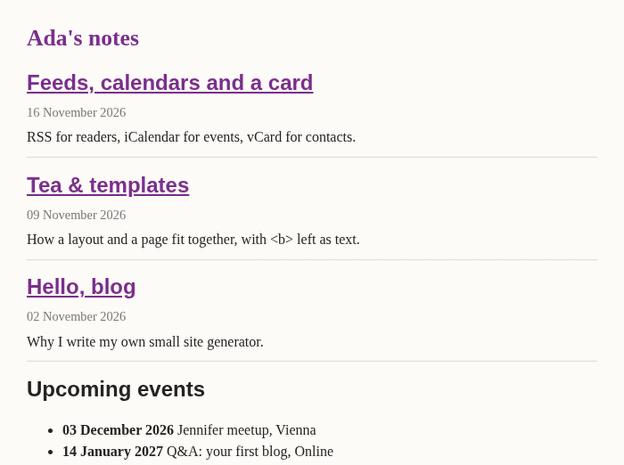
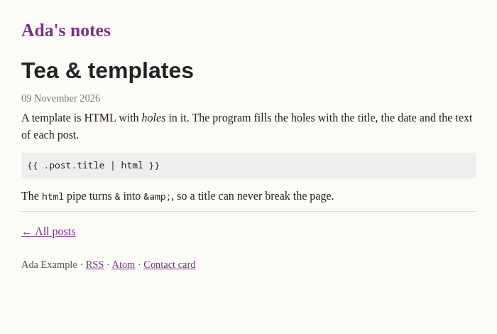

# Your own small blog with Jennifer


Markdown posts in, a finished website out: pages, a feed, a calendar and a
contact card, built by one small program you can read from top to bottom.

Based on **Jennifer 0.26.0**, November 2026, by [@mplx](https://github.com/mplx).

<!-- notes:
In this talk we build a static site generator: a program that reads a folder
of blog posts written in Markdown and writes a folder of finished web pages.
Big tools do the same, but ours is under two hundred lines, so you can see
every step. You should know variables, loops, lists, maps and functions; the
talk Learning programming with Jennifer covers all of them. Every output on
these slides comes from a real run.
-->

---

## What we build

```text
blog/                          public/
  site.toml     title, author    index.html
  events.toml   upcoming events  posts/hello-blog/index.html
  posts/*.md    the posts        feed.xml, atom.xml
  templates/    page layouts     events.ics, author.vcf
  build.j  ->  writes public/    serve.j: preview in a browser
```

- **Static** means: built once, then served as plain files
- Any web server, or a free static host, can publish `public/`

<!-- notes:
On the left is what you write by hand: a settings file, a list of events, one
Markdown file per post and three templates. On the right is what build.j
writes. A static site has no program running on the server and no database;
every page is a finished file. That makes it fast, cheap and hard to break.
The second small program, serve.j, lets you look at the result before you
publish it.
-->

---

## A post is a Markdown file

```markdown
+++
title = "Tea & templates"
date = 2026-11-09
summary = "How a layout and a page fit together."
+++

A template is HTML with *holes* in it. The program fills
the holes with the title, the date and the text of each post.
```

File name: `posts/2026-11-09-tea-and-templates.md`

<!-- notes:
Each post starts with front matter: a few settings between two lines of three
plus signs, written in TOML, the same format as Jennifer's deck manifests.
Below it comes the text in Markdown. If Markdown is new to you, the talk
Introduction to Markdown in this academy explains the syntax. The date at the
start of the file name keeps the files in order, and the rest of the name
becomes the address of the page.
-->

---

## Splitting front matter from text

```jennifer excerpt
func readPost(file as string) {
    def text as string init fs.readString($file);
    if (not strings.startsWith($text, "+++\n")) {
        throw Error{kind: "blog", message: "{$file}: no +++ at the top"};
    }
    def stop as int init strings.indexOf($text, "\n+++\n", 4);
    if ($stop < 0) {
        throw Error{kind: "blog", message: "{$file}: no closing +++"};
    }
    def meta as toml.Value init toml.decode($text[4..$stop]);
    ...
```

<!-- notes:
fs.readString reads the whole file into one string. If it does not start with
the three plus signs, we stop with a clear error instead of guessing. indexOf
finds the closing line, searching from position four, just after the opening
one. Strings in Jennifer are cut with slices: text from four to stop is the
TOML part, and toml.decode turns it into a value we can ask questions.
-->

---

## From front matter to a Post

```jennifer excerpt
def struct Post {
    slug as string, title as string, date as time.Time,
    summary as string, body as string
};
    ...
    return Post{
        slug: path.stem($file)[11..],
        title: toml.asString($meta, "/title"),
        date: toml.asDatetime($meta, "/date"),
        summary: toml.asString($meta, "/summary"),
        body: markdown.toHtml($text[$stop + 5..])
    };
```

<!-- notes:
A struct groups the five things we need about a post. path.stem gives the
file name without the .md, and slicing from eleven drops the date and its
hyphen, so the slug is tea-and-templates. Each asString or asDatetime reads one
key and throws if it is missing or has the wrong type, so a typo in a post
stops the build with a message. Everything after the closing line is the body.
-->

---

## Markdown becomes HTML

```jennifer
# markdown-demo.j - one Markdown string to HTML
use io;
import "markdown.j" as markdown;

def md as string init "## Why?\n\nA **small** program, *my* rules.\n";
io.printf("%s\n", markdown.toHtml($md));
```

```text
<h2>Why?</h2><p>A <strong>small</strong> program, <em>my</em> rules.</p>
```

<!-- notes:
The markdown module does the hard work in one call. toHtml reads CommonMark
plus tables, task lists and a few more extensions, and gives back HTML.
It is safe by default: raw HTML typed into a post is shown as text, not run,
so a pasted script tag cannot sneak into your page. For your own trusted
posts, toHtmlWith with allowRawHtml switches that off.
-->

---

## All posts, newest first

```jennifer excerpt
func loadPosts(dir as string) {
    def posts as list of Post init [];
    for (def name in fs.list($dir)) {
        if (path.ext($name) == ".md") {
            $posts[] = readPost(path.join($dir, $name));
        }
    }
    return lists.reverse($posts);
}
```

<!-- notes:
fs.list returns the names in a folder, sorted. Because every file name starts
with its date, sorted by name means sorted by date, oldest first. We skip
anything that is not a Markdown file, read each post, and reverse the list so
the newest post comes first, as readers expect on a blog. path.join puts the
folder and the name together with the right separator.
-->

---

## A template is HTML with holes

```html
<!doctype html>
<html lang="en">
<head>
<title>{{ .title | html }} - {{ .site.title | html }}</title>
<link rel="alternate" type="application/rss+xml" href="/feed.xml">
</head>
<body>
<header><a href="/">{{ .site.title | html }}</a></header>
<main>{{ block "content" . }}{{ end }}</main>
<footer>{{ .site.author | html }} ... </footer>
</body>
</html>
```

<!-- notes:
This is templates/layout.tmpl, shortened: the real file also holds the style
sheet. Everything between double curly braces is a hole. Dot title reads the
key title from the data we hand over, dot site dot title reads a nested key.
The block line is the place where each page puts its own content. The pipe
into html we will look at in a moment; it is about safety.
-->

---

## Pages fill the layout

```html
{{ define "content" }}
{{ range .posts }}
<article>
  <h2><a href="/posts/{{ .slug }}/">{{ .title | html }}</a></h2>
  <p class="date">{{ .date }}</p>
  <p>{{ .summary | html }}</p>
</article>
{{ end }}
{{ .events }}
{{ end }}
```

<!-- notes:
This is index.tmpl, the home page, slightly shortened. define content fills
the hole the layout left open. range repeats its part once for each post in
the list, and inside it the dot means the current post. post.tmpl looks the
same, without range: it shows one title, one date and the body. The tengine
module follows the style of Go and Hugo templates, if you know those.
-->

---

## Handing data to a template

```jennifer excerpt
func renderPage(page as string, data as json.Value) {
    def set as tengine.Set init tengine.newSet();
    def layout as string init fs.readString("templates/layout.tmpl");
    $set = tengine.add($set, "layout", $layout);
    def body as string init fs.readString("templates/" + $page);
    $set = tengine.add($set, "page", $body);
    return tengine.render($set, "layout", $data);
}
    ...
    $data = json.set($data, "/title", $p.title);
    $data = json.set($data, "/post", postData($p));
```

<!-- notes:
A template set holds the layout and one page; rendering the layout pulls the
page's content block in. The data is a JSON value: json.map turns a Jennifer
map into one, and json.set adds a key. postData builds a small map of slug,
title, date, summary and body for one post. In Jennifer 0.26.0 every render
keeps a little memory behind; that is fixed in the next release and does not
matter for a build that runs once.
-->

---

## Templates do not escape for you

```jennifer excerpt
$set = tengine.add($set, "raw", '<h1>{{ .title }}</h1>');
$set = tengine.add($set, "safe", '<h1>{{ .title | html }}</h1>');
def data as json.Value init json.map({"title": "Tea & <i>cake</i>"});
```

```text
<h1>Tea & <i>cake</i></h1>
<h1>Tea &amp; &lt;i&gt;cake&lt;/i&gt;</h1>
```

- `| html` on every value that is text, never on the body

<!-- notes:
tengine prints a value exactly as it is. A title with an ampersand or an angle
bracket would then be read by the browser as markup, and text from someone
else could even carry a script. The html pipe turns those characters into
entities, so the browser shows them as text. The body is the one exception:
it is already HTML from the markdown module, so it goes in unpiped. Write
templates in single-quoted raw strings: the braces would be holes in double
quotes.
-->

---

## Building HTML in code: the html module

```jennifer excerpt
for (def ev in $events) {
    def day as html.Node init html.text(showDate($ev.start));
    def kids as list of html.Node init [];
    $kids[] = html.element("strong", [], [$day]);
    $kids[] = html.text(" " + $ev.summary + ", " + $ev.location);
    $items[] = html.element("li", [], $kids);
}
return html.render(html.element("ul", [], $items));
```

```text
<li><strong>03 December 2026</strong> Jennifer meetup, Vienna</li>
<li><strong>14 January 2027</strong> Q&amp;A: your first blog, Online</li>
```

<!-- notes:
When the program itself builds a piece of HTML, such as the list of upcoming
events, the html module is the safer tool. html.text makes a text node and
html.element an element with attributes and children. render escapes every
text for you, so Q and A comes out with an entity and you cannot forget it.
The finished string goes into the template unpiped, like the body.
-->

---

## Writing the site with fs

```jennifer excerpt
func writeFile(file as string, content as string) {
    fs.mkdirAll(path.dir($file));
    fs.writeString($file, $content);
    io.printf("wrote %s\n", $file);
}
```

```text
$ jennifer run build.j
wrote public/posts/feeds/index.html
wrote public/posts/tea-and-templates/index.html
wrote public/posts/hello-blog/index.html
wrote public/index.html
...
```

<!-- notes:
Every output file goes through this helper. mkdirAll creates the folder and
any missing parents, like mkdir dash p, so a post's own folder appears when it
is needed. Each post lives at posts slash slug slash index.html, which gives
it a clean address ending in a slash. Run the build again after every change;
it rewrites the files, which takes well under a second here.
-->

---

## The home page



<!-- notes:
This is public/index.html in a browser. The three posts are in the order
loadPosts gave them, newest first, each with its link, date and summary. The
ampersand in Tea and templates and the angle brackets in its summary show as
text, thanks to the html pipe. Below them is the event list the html module
built; the footer below it, cut off here, links to the feeds and the card.
-->

---

## A post page



<!-- notes:
This is one post page. The body came from Markdown: the word holes is in
italics, the code block is a pre element, and the inline code is set in a
fixed font. Notice that the template braces inside the code block are shown
as they are: the body is put into the page as finished text, and tengine
does not look for holes inside a value.
-->

---

## A feed for readers

```jennifer excerpt
for (def p in $posts) {
    def link as string init "{$url}/posts/{$p.slug}/";
    def e as feed.Entry init feed.entry($p.title, $link);
    $e = feed.entryId($e, $link);
    $e = feed.entryPublished($e, $p.date);
    $e = feed.entrySummary($e, $p.summary);
    $entries[] = $e;
}
def f as feed.Feed init feed.feed($title, $url);
$f = feed.feedUpdated($f, $posts[0].date);
return feed.addAll($f, $entries);
```

<!-- notes:
A feed lets people follow the blog in a feed reader without visiting it. Each
post becomes an entry with a full address, a stable id, a date and a summary.
Every feed call returns a new value, so we assign the result back. addAll adds
the whole list in one call, which is much faster than adding one entry at a
time. feed.build then writes it as RSS or as Atom from the same value.
-->

---

## The RSS it writes

```text
$ xmllint --format public/feed.xml | head -n 13
<?xml version="1.0"?>
<rss version="2.0">
  <channel>
    <title>Ada's notes</title>
    <link>https://blog.example.org</link>
    <lastBuildDate>Mon, 16 Nov 2026 00:00:00 +0000</lastBuildDate>
    <item>
      <title>Feeds, calendars and a card</title>
      <link>https://blog.example.org/posts/feeds/</link>
      <guid>https://blog.example.org/posts/feeds/</guid>
      <pubDate>Mon, 16 Nov 2026 00:00:00 +0000</pubDate>
      <description>RSS for readers, iCalendar for events, ...
```

<!-- notes:
feed.build writes the XML on one line, so xmllint formats it here for reading;
the last line is cut to fit. Titles and summaries are escaped for XML, so Tea
and templates arrives intact. A date-only post is published at midnight UTC.
We only build feeds here. Reading other people's RSS with feed.parse in 0.26.0
can turn some date forms into 1970; the next release fixes that.
-->

---

## Upcoming events as a calendar

```jennifer excerpt
def doc as toml.Value init toml.decode(fs.readString($file));
for (def i in 0..toml.length($doc, "/event")) {
    def e as toml.Value init toml.get($doc, "/event/{$i}");
    def ev as ical.Event init ical.event(
        toml.asString($e, "/id"),
        toml.asDatetime($e, "/start"),
        toml.asDatetime($e, "/end"),
        toml.asString($e, "/title"));
    $ev = ical.locate($ev, toml.asString($e, "/place"));
    if (time.after($ev.start, time.now())) {
        $events[] = $ev;
```

<!-- notes:
events.toml lists events as an array of tables, each starting with double
square brackets around the word event. For each one we build an ical event
with a unique id, a start, an end and a title, and add the place. Only events
that are still in the future are kept, so a past meetup disappears on the next
build by itself. The same list feeds the home page and the calendar file.
-->

---

## The events.ics file

```text
BEGIN:VCALENDAR
VERSION:2.0
PRODID:-//Jennifer//ical//EN
BEGIN:VEVENT
UID:meetup-2026-12@blog.example.org
DTSTAMP:20261203T180000Z
DTSTART:20261203T180000Z
DTEND:20261203T200000Z
SUMMARY:Jennifer meetup
LOCATION:Vienna
END:VEVENT
...
```

<!-- notes:
ical.add puts each event into a calendar and ical.encode writes this text,
the iCalendar format that every calendar app imports. Times are always written
in UTC, ending in Z, and lines end in carriage return and line feed as the
standard asks. A visitor who clicks the link gets both events at once. We
only write calendars here; parsing them in 0.26.0 is more lenient than it
should be, which the next release tightens.
-->

---

## A contact card for the author

```jennifer excerpt
def c as vcard.Card init vcard.card($site["author"]);
$c = vcard.withName($c, $site["family"], $site["given"]);
$c = vcard.addEmail($c, $site["email"]);
$c = vcard.withUrl($c, $site["url"]);
$c = vcard.withNote($c, "Writes about Jennifer.");
return vcard.encode($c);
```

```text
BEGIN:VCARD
VERSION:4.0
FN:Ada Example
N:Example;Ada;;;
EMAIL:ada@example.org
...
```

<!-- notes:
vcard is the contacts cousin of ical and works the same way: start a card
with the display name, add pieces, and encode it. The N line holds family
name and given name separated by semicolons. An address book opens
author.vcf and offers to save the contact. The values come from site.toml,
read into a map of strings with toml.keys at the start of the build.
-->

---

## Previewing with a tiny web server

```jennifer
# serve.j - preview public/ at http://127.0.0.1:8080/
use httpd;
use io;

def srv as httpd.Server init httpd.listen("127.0.0.1:8080");
io.printf("preview at http://127.0.0.1:8080/ (Ctrl-C stops)\n");
while (true) { # lint-disable: L105
    def req as httpd.Request init httpd.accept($srv);
    io.printf("%s %s\n", httpd.method($req), httpd.path($req));
    httpd.serveDir($req, "public");
}
```

<!-- notes:
Opening the files straight from disk breaks the links that start with a
slash, so we serve the folder. httpd.listen opens the port on this computer
only; accept waits for the next request, and serveDir answers it with the
matching file, index.html for a folder. The loop never ends on purpose, which
the lint comment says; Ctrl-C stops it.
-->

---

## What the server sees

```text
$ jennifer run serve.j
preview at http://127.0.0.1:8080/ (Ctrl-C stops)
GET /
GET /favicon.ico
GET /posts/tea-and-templates/
GET /favicon.ico
```

- `serveDir` sets the type: `text/xml`, `text/calendar`, `text/vcard`
- A path with `..` cannot climb out of `public/`
- Edit, run `build.j` again, reload the browser

<!-- notes:
Each line is one request from the browser: the home page, the post, and the
little icon browsers always ask for, which we do not have, so it gets a not
found answer. serveDir also tells the browser what kind of file it sends, so
a click on the calendar link opens your calendar app. It refuses paths that
try to leave the folder, but it is meant for previews, not the open internet.
-->

---

## Where to go next

- Add tags: a `tags = [...]` list in front matter, one page per tag
- Show an excerpt with tengine's `truncate` pipe
- The syntax for your posts: [Introduction to Markdown](https://academy.jennifer-lang.dev/talks/mplx/markdown/)
- The basics: [Learning programming with Jennifer](https://academy.jennifer-lang.dev/talks/mplx/learning-programming/)
- Every module used here: [docs.jennifer-lang.dev](https://docs.jennifer-lang.dev/)

<!-- notes:
That is a whole blog: posts in Markdown, pages from templates, safe escaping,
a feed, a calendar and a contact card, written to a folder and previewed in a
browser. The complete programs are in the code folder of this talk. Good next
steps are tags, which are a list in the front matter and a range in a
template, and short excerpts on the home page.
-->
