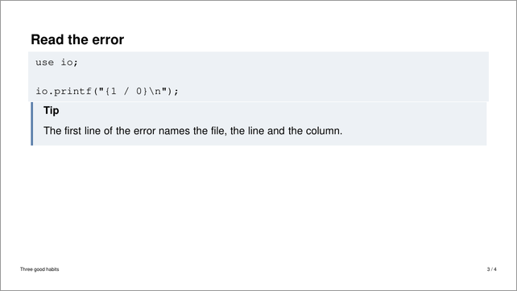

# Slides with Cantrip


One Markdown file in, a browser slideshow and a PDF out.

Based on **Jennifer 0.26.0** and Cantrip 0.3.1, November 2026, by [@mplx](https://github.com/mplx).

<!-- notes:
Cantrip is the slide tool of the Jennifer project, a program written in
Jennifer. Every talk in this academy, this one included, is a Cantrip deck.
We go through the whole format: slides, front matter, notes, themes, code and
pictures, then the keys for presenting, the PDF, and how the academy builds
and checks its talks with it. The outputs shown come from real runs of
Cantrip 0.3.1.
-->

---

## One file in, two files out

```text
$ cantrip build talk.md -v
wrote talk.html (4 slide(s), 29496 bytes)
wrote talk.pdf (4 slide(s), 3761 bytes)
```

- **HTML**: one file, styles and script inlined, nothing fetched; works over
  `file://` on a laptop without network
- **PDF**: one page per slide at the deck's ratio, bookmarks, running footer

<!-- notes:
The slideshow is a single HTML file of about thirty kilobytes for a small deck.
It loads no fonts, no scripts and no styles from anywhere, so it opens the same
on a conference laptop with no Wi-Fi. The PDF is the handout: one page per
slide, the size of the slide rather than a sheet of paper, so a viewer shows
it full screen. Both come out of one parse of the Markdown.
-->

---

## Install and run

```sh
jvc app install https://github.com/jennifer-language/cantrip
cantrip build talk.md
```

Or from a checkout, no build step:

```sh
git clone https://github.com/jennifer-language/cantrip
./cantrip/bin/cantrip build talk.md
```

Needs Jennifer 0.26.0 or newer; no `net`, `exec` or `sql`, so it runs on
`jennifer-tiny` too.

<!-- notes:
jvc, Jennifer's package manager, installs Cantrip as an app: a command on your
PATH. From a git checkout you run the launcher directly, which is what this
academy's checker does. Cantrip uses only modules that ship with the
interpreter: markdown to parse and lay out, pdf to write the file, html to
escape, args for the command line. It never touches the network, which is why
the small embeddable interpreter can run it.
-->

---

## Slides are separated by three dashes

````markdown
# The first slide

Some text.

---

## The second slide

- a point
- another point
````

- A line of `---` (three or more) starts the next slide
- `***` stays a horizontal rule; `---` inside a code fence is code

<!-- notes:
That is the whole idea of the format: ordinary Markdown, cut into slides by a
line of dashes. Empty chunks are dropped, so two separators in a row make no
blank slide. Because dashes are taken for the separator, use three stars for a
rule inside a slide. A code fence protects its contents, which is how this
slide can show a separator at all: the example sits in a fence of four
backticks.
-->

---

## Front matter sets up the deck

````markdown
---
title: Three good habits
author: mplx
theme: nordic
mode: dark
ratio: 16:9
transition: slide
---
````

Also: `date`, `description`, `subject`, `keywords`, `lang`, `notes`,
`slide`, `overview`.

<!-- notes:
Front matter is recognised only when the very first line of the file is three
dashes, and it ends at the next line of dashes. One name and value per line,
quoted or not. title and author go into the HTML meta tags and the PDF
properties; without a title, the first heading is used. Unknown keys are kept
and ignored, so other tools can store their own settings there. A flag on the
command line beats the file.
-->

---

## Speaker notes

````markdown
## Commit small

- one change per commit

<!-- notes: small commits are easy to review and easy to revert -->
````

- **HTML**: in the page but hidden; <kbd>s</kbd> opens the notes panel
- **PDF**: left out; `--notes` puts them in for your own copy
- `--no-notes` removes them from the HTML you publish

<!-- notes:
Notes live in an HTML comment that starts with the word notes and a colon, so
any other Markdown viewer, a forge for instance, simply hides them. A note may
span several lines, as this one does. The defaults point in opposite
directions on purpose: you present from the HTML, so notes are in; the PDF
goes to the audience, so notes are out. Each flag flips one of them.
-->

---

## Themes and modes

- **13 themes**, each with a light and a dark palette
- Cantrip's own: `plain` (default), `solar`, `contrast`
- Grimoire's, same names and colours: `carbon` `ember` `grimoire` `ivy`
  `meridian` `nordic` `obsidian` `orchid` `sepia` `terminal`
- `mode: dark` opens dark; the viewer flips with <kbd>m</kbd>

```text
$ cantrip html talk.md --theme nosuch
cantrip: unknown theme "nosuch"; known: plain, solar, contrast, carbon, ...
```

<!-- notes:
A theme is two palettes, three font stacks and a corner radius. The fonts are
system fonts, so nothing is downloaded. contrast is the one for a bad
projector in a bright room. The ten Grimoire themes let a talk wear the same
look as the manual beside it. An unknown name stops the build with exit code 1
and lists the real ones instead of silently falling back. This talk uses
ember.
-->

---

## Ratios and transitions

| Ratio | Slideshow | PDF page |
| --- | --- | --- |
| `16:9` (default) | 1280 x 720 px | 960 x 540 pt |
| `16:10` | 1280 x 800 px | 960 x 600 pt |
| `4:3` | 1024 x 768 px | 792 x 594 pt |

Transitions: `fade` (default), `slide`, `zoom`, `none`

<!-- notes:
The stage is a fixed box scaled to the window, so the layout never reflows:
what you rehearse on a laptop is what the room sees on the projector. 16:9
suits modern projectors and video calls, 4:3 old installations. Transitions
take under half a second and never delay a key press. A viewer whose system
asks for reduced motion gets no animation, whatever the deck says.
-->

---

## Code blocks

````markdown
```jennifer
use io;

io.printf("{1 / 0}\n");
```
````

- The language survives: `<code class="language-jennifer">`
- No highlighter shipped, nothing loaded from a CDN
- Show a fence inside a fence with a **longer** outer fence

<!-- notes:
Code keeps every space and blank line. The word after the opening fence ends
up as a class, so you can add a highlighter of your own; Cantrip itself does
not colour code. The example is a real Jennifer program, and running it stops
with "division by zero" and the file, line and column, which is the point of
the slide it came from. A wide code line scrolls in the slideshow and wraps in
the PDF.
-->

---

## Pictures

```markdown

```

- HTML: the path as written, relative to the HTML file
- PDF: read from the deck's own directory, never from outside it
- Missing, outside, or a URL: the PDF shows `[alt text]` instead
- Only a picture alone in its paragraph is drawn in the PDF

<!-- notes:
Keep pictures beside the deck. For the PDF, Cantrip resolves the path against
the deck's directory, whatever directory you run it from, and refuses absolute
paths, paths that climb out with two dots, and links that point outside. So a
deck from a stranger cannot pull a private file into the PDF it builds. Use
--verbose to see each picture that was skipped and why.
-->

---

## More than bullet points

- Tables with alignment, task lists, definition lists
- Callouts: `> [!NOTE]`, `TIP`, `IMPORTANT`, `WARNING`, `CAUTION`
- `~~struck~~`, `==marked==`, H~2~O, x^2^, key caps <kbd>Esc</kbd>
- Raw HTML is shown as text unless you build with `--raw-html`
- Not supported: bare URLs in text, footnotes

<!-- notes:
Rendering goes through the markdown module that ships with Jennifer, a small
CommonMark subset plus the extensions that earn their place on a slide. The
kbd tag is the one piece of HTML always allowed, for key caps. Everything else
in angle brackets is escaped, so a deck from somebody else cannot inject
script into your page. Wrap an address in angle brackets to make it a link.
-->

---

## Presenting

| Key | Does |
| --- | --- |
| <kbd>Space</kbd> <kbd>n</kbd> <kbd>PageDown</kbd> | next slide |
| <kbd>p</kbd> <kbd>PageUp</kbd> | previous slide |
| digits, then <kbd>Enter</kbd> | jump to a slide |
| <kbd>o</kbd> | overview |
| <kbd>s</kbd> / <kbd>m</kbd> / <kbd>f</kbd> | notes / mode / fullscreen |
| <kbd>?</kbd> | all shortcuts |

The slide number is in the URL: `talk.html#4`; `?notes=1` opens the notes.

<!-- notes:
The arrow keys, Home and End work too. On a phone, swipe or tap the left or
right third of the screen; a small button bar stands in for the keys. Because
the current slide is in the address, a reload keeps your place and you can
send a link to slide four. While the notes panel is open the slide is scaled
into the space above it, so the notes never cover it.
-->

---

## The PDF



Built with `theme: nordic` and `mode: dark`: the PDF still prints light.

<!-- notes:
This page comes from a deck with theme nordic and mode dark. The slideshow
opens dark, but the PDF always uses the light palette on white, because it is
the copy that gets printed. Headings print black, code and callouts get the
theme's light print shade, and the footer carries the title and the page
number. The outline in the viewer's sidebar is built from the headings.
-->

---

## When a slide is too full

```text
$ cantrip pdf long.md
wrote long.pdf (4 slide(s))
cantrip: warning: 4 slide(s) took 5 pages; 1 extra page(s) mean at least one slide overflowed

$ cantrip info talk.md
Three good habits: 4 slide(s), 2 with notes
   1 * Three good habits
   2 * Commit small
   3   Read the error
   4   Ask early
```

<!-- notes:
A slide that does not fit continues on a second PDF page, and Cantrip says so
on stderr. The PDF is still complete; the warning is a prompt to split the
slide. info writes nothing and lists the slides with their headings, a star
for each slide with notes. A slide listed without a heading usually means a
separator in the wrong place.
-->

---

## The command line

```sh
cantrip html talk.md --no-notes -o public/talk.html  # audience
cantrip pdf talk.md --notes -o talk-presenter.pdf    # you
cantrip build talk.md --theme contrast --ratio 4:3   # projector
cantrip build intro.md part2.md -o dist/talk         # one deck
cantrip themes
```

Exit code `2`: the command line was wrong. `1`: the deck could not be built.

<!-- notes:
build writes both files, html and pdf one each. For build, --out is a path
without the extension, since two files come out; Cantrip never creates
directories, and never writes over an input file. Several input files make one
deck, numbered straight through, with the first file's front matter. The two
exit codes let a script tell a typo in a command from a broken deck.
-->

---

## How the academy uses Cantrip

- A talk is `talk.md` (theme, ratio, transition, mode) plus `academy.toml`
- `tools/prepare.j` writes title, description, author, date, keywords
  and `notes: open` into a temporary copy
- `tools/build.sh` runs `cantrip html` and `cantrip pdf` per talk
- `tools/check.j` builds every talk and **fails on any warning**,
  checks notes, links, characters and code

```sh
jennifer run tools/check.j talks/mplx/cantrip-slides
```

<!-- notes:
The catalogue data is written once, in academy.toml, and injected into the
front matter of a copy before Cantrip runs, so the slideshow and the PDF carry
it. That is also why every academy talk opens with its notes visible. The
checker turns Cantrip's overflow warning into an error, and adds rules of its
own: at least forty words of notes per slide, only Windows-1252 characters
because of the PDF fonts, and Jennifer code that parses.
-->

---

## Read more

- The manual: [cantrip.jennifer-lang.dev](https://cantrip.jennifer-lang.dev/)
- The source: [jennifer-language/cantrip](https://github.com/jennifer-language/cantrip)
- A deck that explains the format by being it: [sample](https://cantrip.jennifer-lang.dev/sample.html)
- Write a talk yourself: [Jennifer Academy](https://academy.jennifer-lang.dev/)

Based on Jennifer 0.26.0, November 2026.

<!-- notes:
The manual is a Grimoire book and covers every flag and key shown here in more
detail. The sample deck is built and published on every push to Cantrip, so it
always matches the current code. And the academy's contributing guide is
the shortest way from reading talks to giving one: fork, write talk.md and
academy.toml, run the check, open a pull request.
-->
