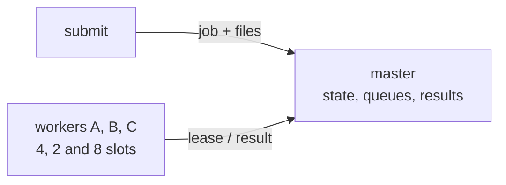
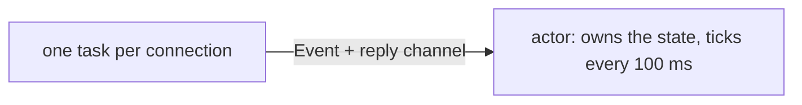

# Distributed computing in Jennifer


A master, workers that find it on the local network, and jobs split into
tasks: the design of demo-distributed.

Based on **Jennifer 0.28.0**, November 2026, by [@mplx](https://github.com/mplx).

<!-- notes:
demo-distributed spreads computations over several machines. It handles
crashed workers, a restarted master and endless jobs, in about 15,000 lines
of Jennifer including tests. This talk covers its design: how a job is
split, who gets the next task, how failures are recovered, and how the
master's state is kept consistent without shared memory.
-->

---

## The problem

- A job needs more cores than one machine has
- Several jobs compete for the same machines
- Machines fail, connections drop, processes restart

The master has to know at all times which tasks are done, which are out,
and which are lost.

<!-- notes:
Starting a program on another machine is the easy part. The bookkeeping is
the hard part: a task was sent but no result came back; a worker stopped
answering, slow or dead; a result arrived twice. Every mechanism in the rest
of the talk exists to keep that bookkeeping correct.
-->

---

## Roles



<!-- notes:
The master holds all state: jobs, tasks, nodes, measurements. A worker holds
nothing that must survive it and runs one task per slot. The client submits a
job and can follow it to its result. Every connection is opened by a worker
or a client, never by the master. One program has every role: distributed
master, worker, submit, and local for a run in one process.
-->

---

## Terms

| Term | Meaning |
| --- | --- |
| **kind** | the code of one type of computation, and its queue |
| **job** | one request to run a kind with options (a spec) |
| **task** | one piece of a job, run by one worker slot |
| **node** / **slot** | a registered worker / one of its tasks-at-a-time |
| **lease** | a task handed to a slot, until its result comes back |

<!-- notes:
The central term is lease. The master lends a task to a slot and can take it
back. When a lease is lost, because the connection closed or the worker
stopped sending heartbeats, the task returns to the queue. Every failure case
later in the talk reduces to that.
-->

---

## A kind: six functions

| Function | Runs on | Does |
| --- | --- | --- |
| `begin(spec)` | master | check options; empty accumulator, first cursor |
| `plan(spec, cursor, units)` | master | the next few task payloads |
| `work(payload)` | worker | one task: a result and its size in units |
| `merge(acc, index, result)` | master | fold one result in, in any order |
| `finish(acc)` / `progress(acc)` | master | the result / one line for the screen |

All values are `json.Value`: they cross the network and are saved.

<!-- notes:
Scheduling, networking, retries and persistence are written once. A new
computation is one file with these six functions in a struct of func values.
Specs, cursors, payloads, results and accumulators are JSON values because
they are sent over the network and written to the master's snapshot. The
worker calls only work.
-->

---

## plan

```jennifer excerpt
func plan(spec as json.Value, at as json.Value, units as int) {
    def next as int init json.asInt($at, "/next");
    def below as int init json.asInt($at, "/below");
    def tasks as list of json.Value;
    while (len($tasks) < BATCH and $next < $below) {
        def hi as int init math.min($next + size($units), $below);
        $tasks[] = json.map({"lo": $next, "hi": $hi});
        $next = $hi;
    }
    $at = json.map({"next": $next, "below": $below});
    return kind.Batch{payloads: $tasks, cursor: $at,
        done: $next >= $below};
}
```

<!-- notes:
The primes kind from the demo's guide, shortened; size returns the measured
budget, or a default before the first measurement. plan returns a few tasks
and a cursor, and the master calls it again as tasks are leased, so a job of
a billion numbers is never a billion tasks in memory. A kind that never
returns done describes an endless job, such as pi.
-->

---

## work

```jennifer excerpt
func work(payload as json.Value) {
    def lo as int init json.asInt($payload, "/lo");
    def hi as int init json.asInt($payload, "/hi");
    return kind.Output{
        result: json.map({"count": countPrimes($lo, $hi)}),
        units: $hi - $lo
    };
}
```

- Pure: a task may run twice, on different workers
- `units` must be proportional to cost: `pi` counts series terms, not digits

<!-- notes:
A task runs twice when its first worker disappears or its result arrives
after the lease expired, so work must return the same result for the same
payload. units is the task's size in the kind's own unit; the master divides
it by compute time to size later tasks. A hex digit of pi far out costs more
than one near the start, so pi counts terms.
-->

---

## merge

```jennifer excerpt
func merge(acc as json.Value, index as int, result as json.Value) {
    def total as int init json.asInt($acc, "/count") + json.asInt($result, "/count");
    return kind.Merged{acc: json.set($acc, "/count", $total), emit: ""};
}
```

- `index`: the task's position in planning order
- The final accumulator must not depend on arrival order
- `emit`: text appended to the job's output file

<!-- notes:
A sum is independent of order, and so is wordcount's merge of word maps. pi
must write its digits in order: its accumulator keeps blocks that arrive
early and emits them once the preceding blocks are in. Order independence is
a property of the accumulator's design; the network does not provide it.
-->

---

## Workers pull

- Each slot opens a connection and sends `Lease{queues}`
- The master answers with a task, or with `Idle{retryMs}`
- Faster workers ask more often, so load balances without configuration
- The master never connects to a worker

<!-- notes:
With push, the master would need every worker's address, capacity and load.
With pull, a free slot is a slot that asks. A worker with eight cores asks
eight times as often as one with a single core. Workers can be behind NAT;
the master needs two ports: 7400 for TCP and 7401 for discovery.
-->

---

## Discovery

```text
worker -> 255.255.255.255:7401  {"distributed": "query", "protocol": 3, "nonce": "..."}
master -> worker                {"distributed": "offer", "protocol": 3, "port": 7400,
                                 "proof": "..."}
```

- The master's address is the offer's source address
- With a token, the offer proves it: HMAC over the query's nonce and the port
- Loopback is queried too: containers and firewalls drop broadcasts
- `--master 10.0.0.5` skips discovery

<!-- notes:
Discovery is one UDP broadcast and 700 milliseconds of listening. The offer
carries only a port; the address comes from the packet, so an offer cannot
point a worker at a third machine. With a token, a worker ignores offers
without a valid proof and keeps listening, so a host without the secret
cannot answer first. The TCP opening then checks both sides again.
-->

---

## Scheduling

1. Highest **priority level**: priority plus one level per ten minutes of waiting
2. Fewest tasks out
3. Served longest ago
4. Submitted first

Jobs of equal priority take turns. Running tasks are not preempted.

<!-- notes:
The scheduler is a sort order over the open jobs. Aging raises a waiting
job by one level every ten minutes, so a low priority is delayed, not
starved. Within a level, fewest tasks out and served longest ago give
round-robin sharing, so an endless job does not block a later one. A high
priority job gets the next free slot.
-->

---

## Task size

- Target: about **2 s** per task (`--task-ms`)
- Units per millisecond per kind, as a moving average
- The kind's default before the first measurement
- The budget grows to at most **4 times** the largest task measured

Smaller tasks: more overhead. Larger tasks: more work lost per failure,
longer waits for higher priorities.

<!-- notes:
The time a block of primes takes depends on the hardware, so the master
measures it. Each result reports units and compute time, and the next plan
call gets a budget for about two seconds. The growth limit stops one bad
early estimate from producing a huge task. pi runs at under one percent
overhead.
-->

---

## Planning window

- Each kind keeps a **window** of queued tasks: twice its active slots
- Open jobs share the window, at least 2 tasks each
- `plan` is called as tasks are leased

Master memory depends on the tasks in flight, not on job size.

<!-- notes:
Planning every task up front would fill memory before the first worker
starts, and an endless job could not be planned at all. The window keeps
enough tasks queued that no slot waits. The cursor holds the whole planning
state of a job; it is small and saved with the rest of the master's state.
-->

---

## Failures

| Event | Master's response |
| --- | --- |
| `work` throws | the task is queued again |
| a slot's connection closes | its lease returns at once |
| no heartbeat for 10 s | the node is gone; all its leases return |
| 3 leases without a result | the job fails, naming the task and error |
| a late or second result | the first result counts, later ones are ignored |

<!-- notes:
Each row returns a lease to the queue. Workers send a heartbeat every two
seconds, which also keeps long tasks leased. The limit of three leases stops
a task that crashes every worker from cycling indefinitely. A late result is
used if the task is still open, which is safe because work is pure.
-->

---

## Exactly-once results

- Delivery is **at least once**: a task may run twice
- `work` is pure, so both runs give the same result
- The master records per task whether its result is in
- The **first result** is merged; `merge` runs once per task

<!-- notes:
Exactly-once delivery is not possible over an unreliable network. At-least-once
execution plus deduplication where results are accepted gives exactly-once
results. Here the deduplication is a flag per task in the master, so a kind
never sees a duplicate and its merge can be a plain sum. Job queues that
advertise exactly-once processing use the same approach.
-->

---

## Restart

- The master's memory is authoritative; `var/` is its record
- A snapshot of the whole state at most every 500 ms, and on shutdown
- On restart, leased tasks are queued again and workers register again
- Output written after the last snapshot is truncated; its tasks run again

`submit --wait` reconnects and continues.

<!-- notes:
A full snapshot is fast enough at this scale. The output file needs care: pi
appends digits as results arrive, some of them after the last snapshot. On
restart the file is truncated to the length recorded in the snapshot, and
the tasks that produced the rest run again, so no digit is written twice.
-->

---

## One owner of the state

`spawn` deep-copies its scope; tasks share no memory.



<!-- notes:
Tasks cannot share the scheduler, so there is no lock. Connection tasks read
and write sockets and send events to an actor, which owns the state, answers
through a reply channel per event, and runs the timers. Discovery has its own
task. The scheduler in src/state.j does no I/O and takes the time as a
parameter, so its tests need no sockets and no sleeping.
-->

---

## A cluster in one process: the worker

```jennifer excerpt
func worker(id as int, inbox as channel of Msg) {
    def reply as channel of int init channel.make(1);
    while (true) {
        channel.send($inbox, message("lease", $id, 0, 0, $reply));
        def index as int init channel.recv($reply);
        if ($index == DONE) {
            return $id;
        }
        channel.send($inbox, message("result", $id, $index, work($index), $reply));
    }
}
```

`code/cluster.j`: three workers, one failing, and a check against a local run.

<!-- notes:
The same design without a network, in about a hundred lines. Workers are
spawned tasks and the master is a loop over one channel. Each worker sends
its reply channel with the lease request, which lets the actor answer that
caller. The full program also handles the retry-later answer and a worker
whose first two tasks fail.
-->

---

## A cluster in one process: the master

```jennifer excerpt
def m as Msg init channel.recv($inbox);
if ($m.what == "lease") {
    def index as int init $queue[0];
    $queue = $queue[1..len($queue)];
    $leases[$index] = $leases[$index] + 1;
    channel.send($m.reply, $index);
} elseif ($m.what == "failed") {
    $queue[] = $m.index;
} elseif (not $finished[$m.index]) {
    $finished[$m.index] = true;
    $total = $total + $m.value;
}
```

<!-- notes:
Shortened from code/cluster.j. The queue, lease counts, finished flags and
total are local variables of one function, and only that function changes
them. The finished flag is the deduplication step. The program prints the
two failed tasks, the results per worker, and the comparison with a local
run.
-->

---

## Cost of moving data

| Kind | Payload | Overhead |
| --- | --- | --- |
| `pi` | a position and a count | under 1 % |
| `sleep` | a duration | one round trip |
| `wordcount` | slices of whole lines | text out, word maps back |
| `exec` | a script name and arguments | a process start |

The World English Bible: 925,038 words, "the" 67,866 times; identical to
`distributed local`.

<!-- notes:
Distribution pays off when computation is expensive and data is small. pi
sends a few numbers and gets a few hex digits back after seconds of
arithmetic. wordcount sends text and gets word maps back, and merging them is
real work on the master. The master's screen shows overhead per kind.
-->

---

## Security

- `--token` or `DISTRIBUTED_TOKEN`: both sides prove the secret with
  HMAC-SHA256 over two fresh nonces and the connection's role; discovery
  offers are signed too
- Without a token, anyone who reaches port 7400 can submit and read results
- Traffic is not encrypted: use a trusted network or a tunnel
- `exec` runs only programs from a worker's `--exec-dir`

<!-- notes:
The secret never crosses the network. Binding the proof to the role stops a
worker's proof from being replayed as a client session, and the master's
proof stops a host that answered discovery from posing as the master. Pass
the token in the environment: command lines are visible to other users. A
worker serves exec only with an exec directory.
-->

---

## Running it

```sh
./bin/distributed master                       # terminal 1: the live screen
./bin/distributed worker --slots 2             # terminal 2
./bin/distributed worker --slots 2             # terminal 3
./bin/distributed submit pi                    # endless: keeps every slot busy
./bin/distributed submit sleep -o seconds=3 -o tasks=20
./bin/distributed submit wordcount -f input=data/web.txt.gz -o top=5 --wait
```

Source: [demo-distributed](https://github.com/jennifer-language/demo-distributed)

<!-- notes:
Four terminals on one machine are enough. The sleep tasks share the slots
with the endless pi job. p on the master's node list pauses a worker;
Control-C in a worker drains it and its tasks move; the master can be
stopped and started again mid-job. docs/writing-a-kind.md in the repository
builds a new kind step by step.
-->

---

## Summary

- One owner of all state: the master's actor
- Leases: every failure becomes a requeue
- Pure `work` plus first-result-wins: exactly-once results
- Lazy planning, task sizes from measurement
- No shared memory between tasks leads to the actor design

<!-- notes:
None of this is specific to Jennifer: job schedulers, build farms and
map-reduce systems work the same way. Jennifer's value semantics rule out a
shared scheduler behind a lock, so the actor is the only design available,
and the scheduler under it is a plain function that is tested without a
network.
-->
