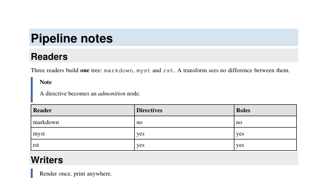

# Inside a document pipeline


doctree, MyST, reStructuredText and fonts: the model under Grimoire and
Cantrip, and how to extend it.

Based on **Jennifer 0.27.0**, November 2026, by [@mplx](https://github.com/mplx).

<!-- notes:
This talk is for people who build or extend document tools: a docs site
generator, a slide builder, a report writer. It opens the box that Grimoire and
Cantrip sit on: one document tree, three readers that fill it, transforms that
rewrite it, and renderers that turn it into HTML and PDF. Then fonts, hostile
input and performance. Every output shown was produced by the released 0.27.0
modules in /usr/share/jennifer/modules, and every program is in the talk's
code folder.
-->

---

## One tree in the middle

```text
markdown.parse  \                     / render("html")   HTML, XHTML
myst.parse       >  doctree.Node  -->   render("ansi")   terminal
rst.parse       /        |            \ renderPdf        PDF over pdf
                     your transforms
```

- Readers never render, renderers never parse
- Grimoire: `markdown.parse`, its own HTML walk, `doctree.renderPdfDoc`
- How to *use* Grimoire: the [Grimoire talk](https://academy.jennifer-lang.dev/talks/mplx/grimoire-docs/)

<!-- notes:
The design is the classic one from docutils and pandoc: parse each input format
into a shared tree, do all the clever work on the tree, and write each output
format from it. Three readers times three writers would be nine converters;
with a tree in the middle it is three plus three, and a transform written once
works for every pair. Grimoire's printed book, for example, parses the whole
book once, rewrites its maths into printable text, and hands the tree to
renderPdfDoc. The Grimoire talk shows the tool from the user's side; this one
stays underneath.
-->

---

## The Node

```jennifer excerpt
export def struct Node {        # modules/doctree.j
    kind as string,             # "heading", "link", "text", ...
    level as int,               # a heading's level
    text as string,             # a leaf's text, an image's alt
    lang as string,             # code language, admonition kind
    ordered as bool,
    url as string,              # link and image target
    title as string,            # link title, admonition title
    align as string,            # table cell alignment
    attrs as map of string to string,   # id, class, ...
    children as list of Node
};
```

<!-- notes:
One struct for every node, the same trick the interpreter uses for values:
a kind string and a field for each thing some kind needs. Blocks are kinds
like document, heading, paragraph, code, list, item, table, quote, admonition,
figure; inlines are text, strong, emphasis, codespan, link, image. Because
doctree ships with Jennifer, a struct literal may leave fields out, so a hand
built node names only what it uses. attrs carries ids and classes; the HTML
writer keeps only an allowlist of attribute names.
-->

---

## Looking at a tree

```jennifer excerpt
func dump(n as doctree.Node, pad as string) {
    io.printf("%s%s%s\n", $pad, $n.kind, ...);   # + a text's "text"
    for (def c in doctree.children($n)) { dump($c, $pad + "  "); }
}
```

```text
document                     link
  heading                      text "that"
    text "Guide"             text "."
  paragraph                list
    text "Read "             item
    strong                     text "one"
      text "this"            item
    text " and "               text "two"
```

<!-- notes:
The source was a heading, a paragraph with bold text and a link, and a two-item
list, which the output cuts off. This little dump is the most useful tool when
you write a transform: run it on a sample of each input format and look at what
the reader really built before you match on it. Note that inline text is split
into runs: "Read ", then a strong node, then " and ". A transform that searches
for a phrase must therefore look across siblings, or use doctree.text on the
parent, which concatenates every descendant.
-->

---

## Selectors are paths, not searches

```jennifer excerpt
doctree.text(doctree.get($doc, "list/item[2]"));      # two
len(doctree.findAll($doc, "paragraph/link"));          # 1
len(doctree.findAll($doc, "link"));                    # 0
doctree.has($doc, "*/strong");                         # true
doctree.attr($link, "href");                           # https://x.org
```

- A step is a kind, `*`, or `kind[k]` (1-based), matching **direct** children
- A bad bracket (`item[0]`) is a kind `"doctree"` error
- Anything deeper than a fixed path: write the recursion yourself

<!-- notes:
The accessors follow the xml and html libraries, so they read familiar, but
the selectors are deliberately small: a slash separated path from the node you
pass, one level per step. findAll of link on the document is zero, because no
link is a direct child of the document; the one link sits inside a paragraph.
That surprises people who expect CSS descendant matching. For a transform that
must find a kind at any depth, a ten-line recursive function is clearer than a
selector language would be, as the next slides show.
-->

---

## Three readers, one tree

```jennifer excerpt
markdown.parse("> [!WARNING]\n> Back up *first*.\n")
myst.parse('```{warning}' + "\nBack up *first*.\n```\n")
rst.parse(".. warning:: Back up *first*.\n")
```

```text
admonition warning: Back up first.
admonition warning: Back up first.
admonition warning: Back up first.
<div class="admonition admonition-warning"><p class="admonition-title">
Warning</p><p>Back up <em>first</em>.</p></div>
```

<!-- notes:
A GitHub™ style alert in Markdown, a MyST directive and a reStructuredText
directive all become the same node: kind admonition, the warning kind in the
lang field, a paragraph inside. Each line came from doctree.get of admonition,
then typeOf, lang and text. The HTML line, wrapped here, is identical for all
three. Note the MyST source is a raw single-quoted string: in a cooked string,
the braces around warning would be read as interpolation and the program would
not even resolve.
-->

---

## MyST: directives, roles, targets

```text
(setup)=                       heading {"id": "setup"}
## Setup                       figure {"id": "fig-pipe"}
```{figure} pipeline.png         image pipeline.png
:name: fig-pipe                  caption > text "The pipeline."
The pipeline.                  admonition note
```                              link #fig-pipe > "The pipeline."
:::{note}                        link #setup > "Setup"
See {numref}`fig-pipe` and       codespan {"class": "kbd"} "Ctrl+C"
{ref}`setup`; {kbd}`Ctrl+C`.   paragraph
:::                              text "{foo}`bar`"
Read {pep}`8`, then {foo}`bar`.
warning line 14: Unknown role "foo"; kept as text.
```

<!-- notes:
Left the source, right the tree, condensed from the dump in directives.j. A
target line gives the next block an id; a directive becomes its own node kind;
roles become inline nodes, and cross references are already resolved to
internal links. Look at the numref: MyST in 0.26.0 shows the figure's caption,
it does not number figures. Unknown things are never dropped: the foo role stays
as text and check reports it. Two sharp edges in 0.26.0, fixed in the next
release: some backtick lines that are not fences are read as fences, and a very
long fence can crash a regular expression.
-->

---

## reStructuredText: the same shapes

```text
Setup                          heading {"id": "setup", "class": "title"}
=====                          figure {"id": "fig-pipe"}
.. _fig-pipe:                  admonition note
.. figure:: pipeline.png         link #fig-pipe > "fig-pipe"
   The pipeline.                 link #setup > "Setup"
.. note:: See fig-pipe_ and      text ":kbd:`Ctrl+C`."
   `Setup`_; :kbd:`Ctrl+C`.    title: Setup
Read :pep:`8`, then missing_.
error line 10: Unknown interpreted text role "kbd".
error line 12: Unknown target name: "missing".
```

- `rst.title`, `rst.docinfo`; `Options{strict: true}` throws `"rst"`

<!-- notes:
The rST reader builds the very same figure, admonition and link nodes, which is
the whole point: a numbering transform written against the tree works for both.
Differences live in the reader. A lone top title is promoted and classed title;
every section gets a slug id; kbd is a Sphinx role, not docutils, so it stays
text with an error. Parsing is lenient and never throws for bad markup; check
returns the diagnostics, and strict mode turns the first one into an error.
-->

---

## A transform: value semantics shape it

```jennifer excerpt
# Pass 1: every figure's "#id", in document order.
func figures(n as doctree.Node) {
    def ids as list of string init [];
    if ($n.kind == "figure") {
        $ids[] = "#" + doctree.attr($n, "id");
    }
    for (def c in doctree.children($n)) {
        $ids = lists.concat($ids, figures($c));
    }
    return $ids;
}
```

No pointers into the tree: read it, then **rebuild** it.

<!-- notes:
Numbered figures are on MyST's not-supported list, so they make a good first
transform. Jennifer has value semantics: there is no reference to a node deep
in the tree that you could mutate in place. So a transform is a function from a
tree to a new tree. The first pass only reads: it collects every figure's id in
order. The node parameter is never written, so the interpreter passes it
without copying, which keeps a read-only walk cheap even on a big document.
-->

---

## Pass 2: rebuild with numbers

```jennifer excerpt
func number(n as doctree.Node, nums as map of string to int) {
    def kids as list of doctree.Node init [];
    for (def c in doctree.children($n)) {
        if ($c.kind == "caption") {
            $c.children = lists.concat([label($n, $nums)], $c.children);
        }
        $kids[] = number($c, $nums);
    }
    $n.children = $kids;
    ...   # a link to a figure's "#id": text "Figure {$nums[$n.url]}"
    return $n;
}
```

<!-- notes:
The second pass rebuilds every node from its rebuilt children, prefixes each
caption, and rewrites every link that points at a figure. The output was: Figure
1. Lexing., then Figure 2. Parsing, after a link reading Figure 1. The shape is
mutate the parameter and return it; lint's L205 suggests exactly that, because
a call written as v equals number of v can then update in place instead of
copying the tree. txt builds a text node, label the Figure N text node.
-->

---

## A table of contents in the tree

```jennifer excerpt
func withToc(doc as doctree.Node) {
    def toc as doctree.Node init doctree.Node{kind: "list"};
    def body as list of doctree.Node init [];
    for (def n in doctree.children($doc)) {
        if ($n.kind == "heading" and $n.level == 2) {
            $n.attrs["id"] = slug(doctree.text($n));
            $toc.children[] = entry($n);     # item > link "#id"
        }
        $body[] = $n;
    }
    ...   # [$body[0], $toc] + the rest
}
```

```text
<h1>Guide</h1><ul><li><a href="#install-it">Install it</a></li>...
```

<!-- notes:
A Markdown heading carries no id, so the transform gives each second level
heading a slug id and builds a list of links to them, inserted after the title.
Because the result is a tree, every renderer gets the table of contents for
free: HTML links, terminal text, and PDF text. MyST and rST also have a contents
directive that does this in the reader. The same pattern does admonition
rewrites, link checks, heading shifts and figure numbering: walk, decide,
rebuild.
-->

---

## HTML: escaped and filtered by default

- `render("html" | "xhtml" | "ansi", doc)`; compact output, no newlines
- Text and `href`s escaped; `javascript:` and other schemes become `#`
- Attributes: an allowlist (`id`, `class`, `data-*`, ...), no `on*`, no `style`
- Raw HTML (`html_block`, `html_inline`) escaped unless trusted:

```jennifer excerpt
doctree.renderHtml($doc, doctree.HtmlOptions{allowRawHtml: true});
```

- ANSI: control characters in the source become U+FFFD

<!-- notes:
The HTML writer builds an html module tree and renders that, so it cannot
produce malformed markup, and every string from the document is escaped. That
is the right default for a docs pipeline that renders pull requests, READMEs or
comments from other people. Opt in to raw HTML only for sources you trust.
Grimoire renders HTML with its own walk over the same tree, to add its anchors
and highlighting; a tool of yours can do the same and keep doctree for the PDF.
-->

---

## PDF: PdfOptions

```jennifer excerpt
def o as doctree.PdfOptions init doctree.pdfDefaults();   # Letter
$o.pageWidth = 595;  $o.pageHeight = 842;  $o.margin = 56;  # A4
$o.bodyFont = "Times-Roman";  $o.boldFont = "Times-Bold";
$o.headingStyles = [doctree.headingStyle(doctree.rgb(214, 228, 240)),
    doctree.headingStyle(doctree.gray(235))];
$o.tableHeaderFill = doctree.gray(225);
$o.codeFill = doctree.gray(245);  $o.codeBorder = doctree.gray(170);
$o.quoteRule = doctree.rgb(70, 110, 160);
$o.title = "Pipeline notes";  $o.bookmarkLevel = 2;
def d as pdf.Document init doctree.renderPdfDoc(myst.parse($src), $o);
fs.writeBytes("notes.pdf", pdf.render(pdf.setFooter($d, $foot)));
```

<!-- notes:
Start from pdfDefaults and change fields: page size and margin in points, the
five font slots, fills for headings by level, table headers, code and quotes,
the Info dictionary and the bookmark depth. renderPdf returns bytes;
renderPdfDoc returns the pdf.Document before serialising, so a running footer
with page x of y can be attached, which is how Grimoire numbers its book's
pages; foot is a pdf.PageLabel, and the full program is book.j. Images
are drawn only when you load their bytes into opts.images yourself.
-->

---

## The page it produced



The city of Gdansk, written with its accented n (U+0144) in the source,
prints as `Gda?sk`: the font slots take only the standard-14 PDF fonts.

<!-- notes:
This is the top of page one, rasterised with pdftoppm. The note directive
became a panel with a rule and a bold label, the table got its header fill,
and both heading levels their colours. The last paragraph of the source names
the city of Gdansk with its accented n, which WinAnsi cannot encode, so the
layout drew a question mark: the unencodable option, default question mark,
picks the replacement. Bookmarks and the Info dictionary keep the text whole,
because a viewer reads them as text instead of drawing them in a font.
-->

---

## Why Unicode text needs an embedded font

```jennifer excerpt
def path as string init "/usr/share/fonts/TTF/DejaVuSans.ttf";
def body as pdf.LoadedFont init pdf.loadFont("Body", fs.readBytes($path));
def s as string init "Gda\u0144sk, \u0394\u03b5\u03bb\u03c6\u03bf\u03af, " +
    "\u041a\u0438\u0435\u0432";
def p as pdf.Page init pdf.textUnicode(pdf.page(300, 60), 12, 24, $body, 16, $s);
def doc as pdf.Document init pdf.addFont(pdf.document(), $body);
```


```text
402743 bytes, 176.296875 pt wide
```

<!-- notes:
The standard-14 fonts live in the viewer and cover WinAnsi only. Anything else
needs the font in the file: pdf embeds a TrueType font as a Type0 composite with
Identity-H encoding, so each character goes through the font's cmap to a glyph
id, and writes a ToUnicode map so the text can still be copied. The price shows
in the size: 0.26.0 embeds the whole 760 KB font, compressed, because there is
no subsetting yet. DejaVu Sans is under the Bitstream Vera™ licence. doctree's
layout itself still uses the standard-14 fonts only.
-->

---

## The font module: what a layout engine needs

```text
DejaVu Sans: 6253 glyphs, 2048 units per em
ascender 1556, descender -492, line gap 410
advance A 1401, V 1401; kern A,V -131
glyph ids of U+006E, U+0144, U+4E2D: [81, 262, 0]
L: M 201 1493 L 403 1493 L 403 170 L 1130 170 L 1130 0 L 201 0 ...
```

- Units / `unitsPerEm` x size = points; y points up
- `glyphIds` batches the cmap lookup; glyph 0 is `.notdef`
- `glyf` and CFF outlines; `kern` table only, no GPOS / GSUB shaping

<!-- notes:
These are the numbers behind every measurement: the em square, the vertical
metrics for line height, advance widths, and pair kerning from the legacy kern
table. The CJK character maps to glyph zero, the notdef box, because DejaVu
lacks it: check for zero before you trust a font with a script. Modern fonts
keep kerning in GPOS, which is out of scope, as is shaping for Arabic or Indic
scripts. A known gap in 0.26.0, fixed in the next release: a font with
unitsPerEm zero is accepted, and divides by zero later.
-->

---

## Outlines and kerning, by hand

```jennifer excerpt
if ($kerned and $prev != 0) {
    $x = $x + font.kern($f, $prev, $cp);
}
def d as string init font.glyphPath($f, $cp);   # font units, y up
$out = $out + "<path transform=\"translate({$x},{$y}) scale(1,-1)\"" + ...;
$x = $x + font.advance($f, $cp);
```


<!-- notes:
glyphs.j writes the word as SVG paths, one per glyph, moving the pen by each
advance; the second line also adds the kern adjustment for each pair, which
pulls A, V, T and A together. pdf's textUnicode does not apply kerning, so a
layout that wants it must place glyph runs itself, the same way. The SVG was
converted to PNG with rsvg-convert. Paths are in font units with y up, hence
the scale of one, minus one.
-->

---

## Hostile input: caps, and kind "limit"

```text
markdown: limit: document nesting too deep (over 100 levels)
myst: limit: document nests too deep (over 50 directive levels)
rst: limit: document nests too deep (document nests too deep (over
  100 levels))
truncated: font: font.parse: malformed font: bytes index 614174 out of
  bounds (len 4000)
```

- Readers: depth caps, a node budget, 20,000 table cells
- PDF layout: a column under 72 pt, too many table columns
- Malformed input keeps its module's kind; a cap is always `"limit"`

<!-- notes:
Each line is a catch printing kind and message: 150 nested quotes, 60 nested
colon fences, 120 nested bullets, and a font cut to 4000 bytes. A pipeline that
renders other people's documents should catch limit separately and answer with
a clear refusal, not a crash. The doubled rST message is a 0.26.0 wrapping
slip, already fixed on main. Also fixed in the next release: rST inline
scanning is quadratic when a line holds many unmatched openers, so cap the
source size yourself.
-->

---

## Sharp edges in 0.26.0

```text
depth 4: 15 ms, 830 bytes            30 levels: 30 <em>
depth 8: 135 ms, 867 bytes           40 levels: 32 <em>
depth 10: 366 ms, 883 bytes
depth 12: 1424 ms, 903 bytes
depth 14: 5390 ms, 920 bytes
```

```jennifer excerpt
if (depth($doc) > PDF_MAX_DEPTH) {   # your own guard, 12 here
    throw Error{kind: "limit", message: "too deep for the PDF layout"};
}
```

<!-- notes:
Left: nested quotes rendered to PDF with quoteFill set. The time roughly
doubles per level, because the quote fill is exponential in nesting depth, and
deep nesting can silently drop content. Right: Markdown emphasis nested 40 deep
keeps only 32 levels, without an error. Both are fixed in the next release.
Until then, measure the tree's depth before rendering and throw your own limit
error, as guard.j does. Timings vary with machine load.
-->

---

## Performance: measure a big document

```text
parse 41 KiB: 1180 ms     html 91 KiB: 672 ms     pdf 84 KiB: 1192 ms

$ jennifer profile big.j
   HITS         SELF           CUM  POSITION
   1600   5.513181ms  1.508165519s  doctree.j:3025:5    renderBlock
    400   1.418027ms  640.145809ms  doctree.j:3047:13   renderTable
   4400  48.715815ms  983.947984ms  markdown_blocks.inc.j:852:9
   4801  32.832298ms  651.475266ms  markdown.j:717:5    inline
```

`profile --allocs`: one 32 MiB copy of the whole tree, `markdown.j:897`

<!-- notes:
big.j repeats a section with a heading, inline markup, a list and a table four
hundred times and times each phase. The statement profile, cut to four rows with
paths shortened and the function names added, shows where it goes: in the PDF,
400 tables take over 40 percent of the layout; in parsing, the block loop and
the inline pass. The allocation profile shows the parser copying the whole tree
once while resolving inlines. Profile your own transforms the same way: a
transform that copies the tree per node is quadratic.
-->

---

## Read more

- Module docs: `doctree.md`, `markdown.md`, `myst.md`, `rst.md`, `font.md`,
  `pdf.md` in [the interpreter repository](https://github.com/jennifer-language/jennifer)
- Users' view: [Docs that build themselves with Grimoire](https://academy.jennifer-lang.dev/talks/mplx/grimoire-docs/)
- The pdf module on its own: [Making PDFs with Jennifer](https://academy.jennifer-lang.dev/talks/mplx/pdf-reports/)
- Every program from these slides: the talk's `code/` folder
- Fonts: DejaVu Sans (Bitstream Vera licence), from `/usr/share/fonts/TTF/`

Based on Jennifer 0.27.0, November 2026.

<!-- notes:
The module pages list every function and option this talk only touched. The
Grimoire talk shows the pipeline from the user's side, and the PDF talk builds
pages by hand with the pdf module that doctree's layout sits on. The code folder
has each program in full, with a README saying how to run it; the font is read
from the system font directory and not shipped with the talk. When a module and
its page disagree, the module wins and the page needs a fix.
-->
