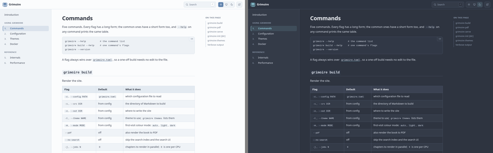

# Docs that build themselves with Grimoire


A folder of Markdown in, a searchable website, a printed book and an EPUB
out, rebuilt by CI on every release.

Based on **Jennifer 0.26.0** and Grimoire 0.5.0, November 2026, by [@mplx](https://github.com/mplx).

<!-- notes:
Grimoire is the documentation builder of the Jennifer project, written in
Jennifer. It builds the language manual, the module reference, Cantrip's
manual and its own. This talk goes from an empty directory to a book on the
web: the outline, the configuration, the PDF and the EPUB, several books from one tree,
plugins, the container image and the CI workflow that publishes it all from a
release tag. Outputs shown are from real runs of Grimoire 0.5.0.
-->

---

## What Grimoire does

- A directory of Markdown becomes a **static website**: themed, with search,
  light and dark mode, an outline and per-page contents
- On request the **whole book as one PDF**: cover, bookmarks, page numbers,
  and as an **EPUB** for e-readers
- The site works from a web root, a subdirectory, or **straight off the disk**
  over `file://`, search included
- Nothing is fetched unless you opt in; same input, **byte-identical** output
- What mdBook and MkDocs do, as one Jennifer program

<!-- notes:
The search index is loaded as a script rather than fetched, which is why
search still works when you double-click index.html from a USB stick. No
fonts, scripts or styles come from a CDN by default; the only settings that
reach off the machine are the optional highlight.js layer and a logo given as
a URL. Byte-identical output means a rebuild without changes changes nothing,
which keeps a deployment diff honest.
-->

---

## Install it, or don't

```sh
jvc app install https://github.com/jennifer-language/grimoire
grimoire --version            # grimoire 0.5.0
```

Or no install at all, only a container runtime:

```sh
docker run --rm --user "$(id -u):$(id -g)" -v "$PWD:/work" \
    ghcr.io/jennifer-language/grimoire:0.5.0 build --pdf
```

Needs Jennifer 0.26.0 or newer; `serve` needs the default binary.

<!-- notes:
jvc, the Jennifer package manager, installs Grimoire as an app, a program with
a command on your PATH, rather than as a library. The container image has
Grimoire as its entrypoint, so everything after the image name is a Grimoire
command; mount the book at /work and that is it. With Podman the flag is
--userns=keep-id instead of --user. The --user flag keeps the files it writes
owned by you rather than by root.
-->

---

## A book in a minute

```text
$ grimoire init my-book
initialising a Grimoire book in my-book/
  wrote   my-book/grimoire.toml
  wrote   my-book/docs/SUMMARY.md
  wrote   my-book/docs/index.md
  wrote   my-book/docs/getting-started/installation.md
  wrote   my-book/docs/getting-started/first-steps.md

$ cd my-book && grimoire build --pdf
built 3 pages into site/ (74 KiB, 0 assets) in 35 ms
  search index: 3 sections
  pdf: site/my-book.pdf (4 KiB)
```

<!-- notes:
init writes a configuration with every key commented, an outline and three
chapters, and never overwrites a file that is already there, so running it
again puts back what you deleted. build writes the site into site/, and with
--pdf the printable book beside it. Thirty-five milliseconds is for three tiny
chapters. Grimoire's performance page measures the Jennifer manual, 155
chapters: the site takes under five seconds on an eight-core machine, because
chapters render in parallel, and the 727-page PDF about half a minute.
-->

---

## The outline: SUMMARY.md

```markdown
# Summary

[Introduction](index.md)

# Getting started

- [Installation](getting-started/installation.md)
- [First steps](getting-started/first-steps.md)
```

- A heading starts a **part**; a link outside a list is an unnumbered chapter
- No `SUMMARY.md`? The **directory tree** becomes the outline

<!-- notes:
This is the file init wrote. It is the mdBook shape, so a book can move over
from mdBook without rewriting its outline, and the heading anchors match
mdBook's and GitHub's too, so hand-written cross references keep working. A
link like guide/syntax.md#anchor is rewritten to the HTML page. For a quick
book, or a generated reference, leave the summary out and Grimoire walks the
folders the way MkDocs does.
-->

---

## grimoire.toml: what most books set

```toml
[book]
title = "My Book"
src = "docs"

[html]
theme = "nordic"            # grimoire themes lists all eleven
editUrl = "https://github.com/me/book/edit/main/docs/{path}"

[highlight]
enabled = true              # Jennifer code coloured at build time

[pdf]
pageNumbers = true
```

<!-- notes:
Every key is optional, and a directory of Markdown builds with no file at all.
A command-line flag always wins over the file, so trying a theme needs no
edit: add --theme nordic to the build command. The built-in highlighter colours
Jennifer while the site is built: no JavaScript, nothing loaded. editUrl puts
an edit-this-page link on every chapter, with the chapter's path filled in.
-->

---

## Eleven themes, each light and dark



`carbon` `ember` `grimoire` `ivy` `meridian` `nordic` `obsidian` `orchid`
`sepia` `sixtyfour` `terminal`

<!-- notes:
The picture is the nordic theme, the same page in light and dark. Every theme
must ship both palettes, so no theme can have a broken dark mode. The reader
picks light, dark or follow-the-system in the top bar, and the choice is
applied before the first paint, so there is no white flash between pages.
The Cantrip themes of the same names use the same colours, so slides can
match the manual next to them.
-->

---

## The printed book

```toml
[pdf]
paper = "a4"                # or "letter"
pageNumbers = true          # page/total in the footer
footerLeft = "My Book {version} {commit}"
bookmarkLevel = 3
exclude = ["api/", "technical/coverage.md"]
```

- `{version}` is the git tag, `{commit}` the short id when there is no tag
- `exclude`: on the site, not on paper; a trailing `/` takes a directory

<!-- notes:
The PDF has a cover, chapters on fresh pages, a nested bookmark outline and
the theme's light colours. Page numbers need the total, which only exists
after the whole book is laid out, so Grimoire stamps them in a second pass.
In a container without git, set GRIMOIRE_VERSION or GRIMOIRE_COMMIT and the
footer still knows. The exclude line is the one the Jennifer manual uses: its
generated API pages and coverage report are not worth printing.
-->

---

## The e-book: EPUB

```toml
[renderer.epub]
output = "my-book.epub"
cover = "assets/cover.png"      # optional
stylesheet = "assets/epub.css"  # optional, a default is built in
```

```text
$ grimoire build --pdf --verbose
  plugin  renderer epub  ->  .../grimoire-epub
  render  epub  ->  my-book.epub
```

- Same outline, reflowable text: a reader that is not a browser
- Ships with Grimoire, and in the container image; nothing to install

<!-- notes:
The third edition beside the site and the PDF comes from the bundled epub
renderer, switched on by naming it. It reads the Markdown, not the built HTML,
so it renders what the book says. Links between chapters and to headings are
rewritten into the archive, and pictures are carried in. A reader refuses a
chapter that is not valid XML, so every chapter is parsed back first: a book
that would produce a broken EPUB fails the build instead. Like the rest, the
same input gives the same bytes.
-->

---

## Several books from one docs/ tree

The Jennifer repository builds two PDFs from `docs/`:

```toml
# grimoire.toml: the manual, without the API pages
[pdf]
exclude = ["api/", "technical/coverage.md"]
```

```toml
# grimoire-api.toml: only the API pages, as their own book
[book]
title = "Jennifer Module API Reference"
src = "docs/api"
```

```sh
grimoire pdf -c grimoire-api.toml --out docs/api
```

<!-- notes:
One source tree, two configurations. The manual's site includes the API pages,
but its PDF leaves them out; a second file with src pointing into docs/api
builds exactly those pages as a book of their own, with its own title, its
own outline from the directory tree, since that folder has no summary, and its
own PDF. Writing that PDF into docs/api before the site build means the site
copies it next to the API pages, where a link can point to it.
-->

---

## Tried on our book

```text
$ grimoire build --pdf --verbose
  ...
  skipped reference/index.md (excluded from the PDF)
  skipped reference/options.md (excluded from the PDF)
  assets  stylesheet, runtime, search index, llms.txt
  copied  0 files from docs
built 5 pages into site/ (88 KiB, 0 assets) in 63 ms
  search index: 6 sections
  pdf: site/my-book.pdf (4 KiB)

$ grimoire pdf -c grimoire-ref.toml
rendered site/my-book-reference.pdf (2 KiB) in 12 ms
```

<!-- notes:
Here the same idea on the small book from before: a reference folder added to
the outline, excluded from the main PDF, and a second configuration of six
lines that renders only that folder. Verbose output names each chapter it leaves
out, so a mistyped exclude path is easy to spot. Both PDFs land in the same
site directory, because the second file does not set a different output.
-->

---

## Plugins are programs

```toml
[preprocessor.include]

[renderer.sitemap]
baseUrl = "https://docs.example.org/"
```

````markdown
```jennifer
{{#include examples/hello.j}}
```
````

- **Preprocessor**: rewrites the Markdown before rendering, so the change
  reaches site, search and PDF
- **Renderer**: runs on the finished site: sitemap, EPUB, link check, feed

<!-- notes:
A plugin is any executable named grimoire-NAME, found beside Grimoire and
then on PATH, or given by a command path in the table. Twelve ship with
Grimoire, among them include, apiref, glossary, macros, sitemap, epub and
linkcheck, and none runs unless the book names it. include is the cure for
stale examples: the code in the chapter is read from the real file at build
time, so it is either right or the build fails.
-->

---

## Know what a book will run

```text
$ grimoire plugins
Programs this book runs, from grimoire.toml:

  preprocessor  include  ->  .../grimoire-include  (ships with Grimoire)
  renderer      sitemap  ->  .../grimoire-sitemap  (ships with Grimoire)

Each one runs with your permissions and can do anything you can.
Nothing is discovered: every program above is named in the file.
```

<!-- notes:
A plugin runs with your permissions, so before building somebody else's book,
ask Grimoire what it would start. A program found on PATH or elsewhere on the
machine is reported as a build warning; one that ships with Grimoire or lives
inside the book passes quietly. The paths are shortened here; the real output
prints them in full. Grimoire itself never touches the network while it
builds.
-->

---

## Writing your own plugin

- Request on **stdin**: one JSON object with `api`, `kind`, `book`,
  `entries` (the outline) and `chapters` (`src`, `content`)
- Reply on **stdout**: the chapters you changed, or for a renderer the files
  you `written` and any `warnings`
- Any language; in Jennifer, copy `src/pluginkit.j` from Grimoire 0.5.0
- Must be **deterministic**: same request, same reply
- Publish it with the [grimoire-plugin](https://github.com/topics/grimoire-plugin) topic on GitHub

<!-- notes:
The contract is version 1 of a small JSON protocol, and the request says so in
its api field; refuse a number you do not know. Features added later, such as
generated files or MathML, are listed in a features array instead of bumping
the version. The plugin kit is one file that handles decoding, settings,
fences and replies. Grimoire promises identical output for identical input, so
a plugin that adds a timestamp breaks that promise for the whole book.
-->

---

## The container image

```sh
# preview with live reload
docker run --rm -p 8080:8080 -v "$PWD:/work" \
    ghcr.io/jennifer-language/grimoire:0.5.0 \
    serve --watch --addr 0.0.0.0:8080
```

| Tag | Is |
| --- | --- |
| `0.5.0` | one release, never changes |
| `0.5` | newest release of that line |
| `latest` | the highest release |
| `dev` | the tip of the default branch |

<!-- notes:
The image is multi-arch, amd64 and arm64, and carries the twelve bundled
plugins. serve binds 127.0.0.1 by default, which inside a container is the
container's own loopback, hence the explicit address. With --watch every save
rebuilds and the open browser tab reloads itself; the reload script is added
to the response only, never written into the site. In CI, pin a version tag
so that next year's build renders like today's.
-->

---

## CI: publish from the latest release

```yaml
on:
  push:
    tags: ["[0-9]+.[0-9]+.[0-9]+"]
  pull_request:
jobs:
  pages:
    permissions: { contents: read, pages: write, id-token: write }
    uses: jennifer-language/grimoire/.github/workflows/docs-pages.yml@0.5.0
    with:
      image: ghcr.io/jennifer-language/grimoire:0.5.0
      args: --pdf
```

<!-- notes:
Grimoire ships a reusable workflow that builds the book inside the image and
deploys it to GitHub Pages. The site is built from the highest release tag, so
readers of the newest release read that release's documentation. A pull
request is built and checked but never published, so a broken book fails the
pull request rather than the next release. Pages must be set to deploy from
GitHub Actions, and the github-pages environment must allow tags.
-->

---

## Pages that write themselves: prepare and check

```yaml
prepare: |
  go build -o jennifer ./cmd/jennifer
  ./jennifer run scripts/gen-module-docs.j
  docker run --rm --user "$(id -u):$(id -g)" \
    -v "$PWD:/work" -w /work \
    "$IMAGE" pdf -c grimoire-api.toml --out /work/docs/api
check: |
  test -s "$SITE/jennifer-manual.pdf"
  test -s "$SITE/api/jennifer-module-api.pdf"
```

<!-- notes:
This is trimmed from the Jennifer repository's own docs workflow. prepare runs
in the checkout of the release before the build: it generates the module API
pages from each module's doc comments, which are never committed, and renders
the second book. check runs after the build and fails the job before anything
is published, so a silently missing PDF never reaches the live site. That is
what "docs that build themselves" means here.
-->

---

## Read more

- The manual, built by itself: [grimoire.jennifer-lang.dev](https://grimoire.jennifer-lang.dev/)
- The source: [jennifer-language/grimoire](https://github.com/jennifer-language/grimoire)
- Plugins by others: [topic grimoire-plugin](https://github.com/topics/grimoire-plugin)
- A book built with it: [docs.jennifer-lang.dev](https://docs.jennifer-lang.dev/)

Based on Jennifer 0.26.0, November 2026.

<!-- notes:
Grimoire's own manual is a Grimoire book, published by the same workflow from
its latest release, and its PDF is linked from the first page. The Jennifer
documentation is the large example: 155 chapters, generated
API pages, two PDFs and a coverage report. Every site also carries llms.txt
and a JSON search index, so programs can read the book as easily as people.
-->
