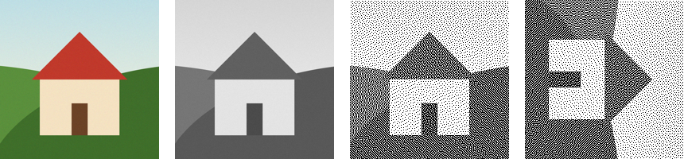
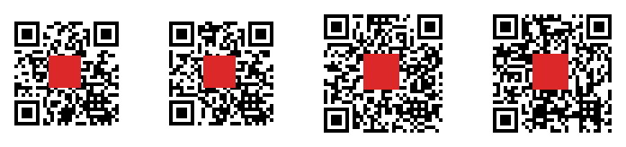
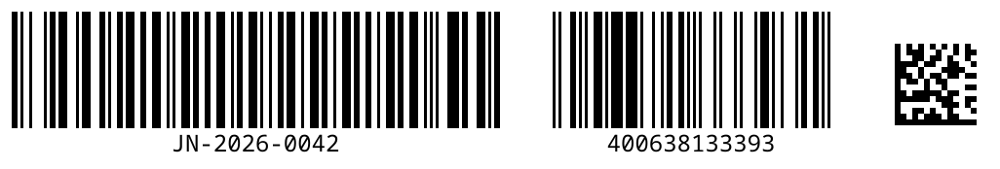
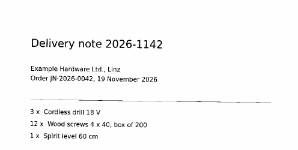
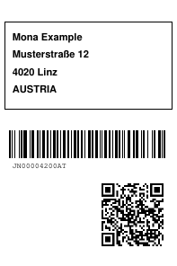

# Images, barcodes and labels with Jennifer


Pictures with `images` and ImageMagick, barcodes you can scan, labels a
printer understands, a scanner that hands you a PDF.

Based on **Jennifer 0.27.0**, November 2026, by [@mplx](https://github.com/mplx).

<!-- notes:
This talk follows a parcel through a small warehouse office: a photo is shrunk
for a web shop, a tracking code is printed as a barcode, a label goes to a
thermal printer, and the signed delivery note comes back through a network
scanner as a PDF. Every program shown was run with Jennifer 0.27.0 and every
output and picture is what it printed or wrote. There is no label printer or
scanner on the desk: those two are played by small loopback stand-ins, which
the notes point out where they appear.
-->

---

## The toolbox

| Name | What | Runs on |
| --- | --- | --- |
| `use images;` | library: PNG, JPEG, GIF in, edit, out | both binaries |
| `@deckyard/magick` | deck: ImageMagick 7, needs `exec` | `jennifer` |
| `import "barcode.j"` | module: QR, DataMatrix, 1D codes as SVG or PNG | both |
| `import "label.j"` | module: ZPL and cab printer commands | both; `send` needs `jennifer` |
| `@deckyard/escl` | deck: network scanners (AirScan, Mopria), needs `net` | `jennifer` |
| `import "pdf.j"` | module: the PDF writer | both |

<!-- notes:
The two binaries are the full jennifer and the small jennifer-tiny build. The
images library, the barcode module, building and rendering labels, and the PDF
writer run on both. The two decks come from the registry with jvc add, and each
declares the capability it needs: magick runs a program, escl opens sockets,
and neither is available on the tiny build. The PDF side is covered in its own
talk; here it only binds pages and draws a label.
-->

---

## Load, look, shrink

```jennifer excerpt
def data as bytes init fs.readBytes("holiday.jpg");
io.printf("%v\n", images.info($data)); # the header only
def photo as images.Image init images.decode($data);
def thumb as images.Image init images.fit($photo, 320, 320);
io.printf("%v\n", $thumb);
fs.writeBytes("thumb.jpg", images.encode("jpeg", $thumb, 85));
fs.writeBytes("thumb.png", images.encode("png", $thumb));
```

```text
images.Info{format: "jpeg", width: 3000, height: 2000}
<images.Image 320x213>
```

<!-- notes:
info reads format and size from the header without decoding a pixel, which is
the cheap check before anything else. decode detects the format itself. fit
scales down into a box and keeps the aspect ratio, so 3000 by 2000 becomes 320
by 213, and it never enlarges a small picture. The pixels stay on the Go side
and images are immutable, so passing them around costs nothing. The 3.3 MB
photo gives a 4,912 byte JPEG at quality 85 and a 70,997 byte PNG: photos
want JPEG.
-->

---

## Crop, resize, turn, dither

```jennifer excerpt
def sq as images.Image init images.crop($img, 1000, 1000, 1000, 1000);
def small as images.Image init images.resize($sq, 200, 0);
def gray as images.Image init images.grayscale($small);
def dots as images.Image init images.dither($gray);
def turned as images.Image init images.rotate($dots, 90);
$strip = images.draw($strip, $small, 0, 0); # ... and the other three
```



<!-- notes:
Each call returns a new image. crop takes x, y, width and height in pixels from
the top left, and the rectangle must lie inside the picture. resize with a 0
keeps the aspect ratio. dither turns gray into black dots by error diffusion,
which is what a thermal label printer or an e-paper display needs; threshold is
the hard cut. rotate takes multiples of 90 only. The strip itself is made with
create and draw, so the picture on this slide is the program's own output.
-->

---

## Hostile pictures

```jennifer excerpt
def data as bytes init fs.readBytes("bomb.png"); # 75 bytes
io.printf("%v\n", images.info($data));
try {
    images.decode($data, 4000000); # 4 Mpx, for uploads
} catch (e) {
    if ($e.kind != "limit") {
        throw $e;
    }
    io.printf("%s\n", $e.message);
}
```

```text
images.Info{format: "png", width: 100000, height: 100000}
images.decode: a 100000x100000 image exceeds the 4000000-pixel limit
```

<!-- notes:
Seventy-five bytes of PNG can claim ten billion pixels, forty gigabytes once
decoded. decode reads the header first and refuses anything over its pixel cap
before it allocates: 64 megapixels by default, 8 on jennifer-tiny. For uploads
pass a lower cap, as here. The refusal is kind "limit", the generic kind every
library uses for a reached cap, so you test the kind and never the message.
A file that is no image at all is a runtime error instead.
-->

---

## What images does not do: @deckyard/magick

```jennifer excerpt
import "@deckyard/magick/" as magick;
def c as magick.Config init magick.config();
def info as magick.Info init magick.identify($c, "phone.jpg");
io.printf("%dx%d %s\n", $info.width, $info.height, $info.orientation);
def img as magick.Image init magick.open($c, "phone.jpg");
$img = magick.thumbnail(magick.autoOrient($img), 640, 640);
$img = magick.annotate($img, "Summer 2026", "SouthEast", 12, 8, 28,
    "white");
magick.write($c, magick.quality($img, 80), "phone.webp");
$info = magick.identify($c, "phone.webp");
io.printf("%s %dx%d\n", $info.format, $info.width, $info.height);
```

```text
1067x1600 LeftBottom
WEBP 640x427
```

<!-- notes:
The phone stored its photo on its side with an EXIF note saying so. The images
library ignores EXIF and decodes it as 1067 by 1600; ImageMagick's autoOrient
turns it upright. WebP, AVIF, HEIC, text, blur and free rotation are
ImageMagick's too. The deck pins every input format, leaves SVG and PDF out
unless allowFormat enables them, and runs each chain as one magick process
with memory, size and time limits. thumbnail also strips the metadata, GPS
position included.
-->

---

## Barcodes: one Symbol, several renderers

```jennifer excerpt
import "barcode.j" as barcode;
def opts as barcode.Options init barcode.defaults();
$opts.scale = 4;
for (def ec in ["L", "M", "Q", "H"]) {
    $opts.ecLevel = $ec;
    def qr as barcode.Symbol init barcode.encode("qr",
        "https://academy.jennifer-lang.dev/", $opts);
    def png as bytes init barcode.png($qr, $opts);
    fs.writeBytes("qr-{$ec}.png", $png);
    io.printf("%s: %d modules, %d bytes\n", $ec, $qr.size, len($png));
}
```

```text
L: 29 modules, 1347 bytes      Q: 33 modules, 1756 bytes
M: 29 modules, 1325 bytes      H: 33 modules, 1715 bytes
```

<!-- notes:
encode builds a device-independent Symbol: a module grid for 2D codes, bar
widths for 1D ones. svg, png and matrix turn it into output; terminal draws a
QR with block characters for a shell. The error-correction level is how much
of the code may be lost: about 7, 15, 25 and 30 percent for L, M, Q and H.
More correction means more modules, so the same URL grows from version 3 to
version 4. The output is two runs of the loop, put side by side to fit.
-->

---

## Error correction, tested with a sticker

```jennifer excerpt
def hit as images.Image init images.fill($m, 3 * $q, 3 * $q, 2 * $q,
    2 * $q, $red); # a sticker in the middle
```



```text
$ for l in L M Q H; do echo $l: $(zbarimg -q hit-$l.png || echo none); done
L: none
M: none
Q: QR-Code:https://academy.jennifer-lang.dev/
H: QR-Code:https://academy.jennifer-lang.dev/
```

<!-- notes:
The images library paints an opaque square over a quarter of each code's width,
right through the data. zbarimg, the reader from the ZBar project, gives up on
L and M and still reads Q and H. That is the case for Q or H on anything that
gets handled: a parcel label gets scuffed, folded and stamped. For a URL shown
on a screen, M is the usual choice and the default. Test your codes with a
reader like this in CI, not with your own eyes.
-->

---

## Four more symbologies

```jennifer excerpt
def o as barcode.Options init barcode.defaults();
$o.scale = 3;
def jobs as list of list of string init [
    ["code128", "JN-2026-0042"],
    ["ean13", "400638133393"],
    ["gs1-128", "(01)09012345678901(10)LOT42"],
    ["datamatrix", "JN-2026-0042"]
];
for (def job in $jobs) {
    def s as barcode.Symbol init barcode.encode($job[0], $job[1], $o);
    fs.writeBytes($job[0] + ".png", barcode.png($s, $o));
    fs.writeString($job[0] + ".svg", barcode.svg($s, $o));
}
```

<!-- notes:
Code 128 carries any printable ASCII and is the usual choice for your own
numbers. EAN-13 is the retail code; given twelve digits it computes the
thirteenth, given thirteen it checks it and throws on a typo. GS1-128 is Code
128 with FNC1 markers: product number (01), batch (10). DataMatrix holds the
same text in a much smaller square, up to 44 codewords in 0.26.0. Other
symbologies: code39, code93, ean8, upca, upce and itf.
-->

---

## Scan them back



```text
$ zbarimg -q code128.png ean13.png gs1-128.png
CODE-128:JN-2026-0042
EAN-13:4006381333931
CODE-128:010901234567890110LOT42
$ ZXingReader datamatrix.png | head -1
Text:       "JN-2026-0042"
```

<!-- notes:
zbarimg reads the 1D codes and marks the GS1-128 one with the GS1 modifier in
its XML output; it has no DataMatrix decoder, so ZXingReader from zxing-cpp
reads that one. Notice the EAN line under the bars: it shows the twelve digits
that were passed in, while the bars carry the thirteenth, the computed 1. Pass
all thirteen digits when the printed line matters. The two linear codes here
are rendered from the SVG files, the DataMatrix from the PNG.
-->

---

## SVG or PNG

| | `barcode.svg` | `barcode.png` |
| --- | --- | --- |
| Scales | without loss: web, email, PDF via a converter | in whole pixels: `scale` per module |
| Colours | `foreground`, `background` | black on white |
| Text line under 1D codes | yes (`humanReadable`) | no |
| Code 128 above, bytes | 3,059 | 557 |

- Leave a **quiet zone**: `quiet` is in modules, default 4
- Print at whole dots per module; do not stretch a PNG by 1.3

<!-- notes:
An SVG embeds in HTML as it is and stays sharp at any size; colours are checked
so a crafted value cannot break out of the attribute. The PNG is a small
grayscale file the module writes without any image library, which suits a
label PDF or a printer. The quiet zone is the empty margin a scanner needs:
four modules is right for QR, while Code 128 asks for ten and EAN-13 for eleven
on the left. In 0.26.0
the module silently clamps scale, quiet and height; the next release refuses
values out of range.
-->

---

## Labels: build, render, emit

```jennifer excerpt
def t as label.TextOptions;
$t.height = 5.0;
def b as label.BarcodeOptions;
$b.height = 10.0;
def l as label.Label init label.new(50.0, 30.0); # millimetres
$l = label.box($l, 1.0, 1.0, 48.0, 28.0, 0.4);
$l = label.text($l, 4.0, 4.0, $t, "Shelf A-17");
$l = label.barcode($l, "code128", 4.0, 12.0, $b, "A17-0042");
$l = label.quantity($l, 2);
io.printf("%s\n", label.render($l, label.zpl(203)));
io.printf("%s", label.render($l, label.cab()));
```

<!-- notes:
barcode draws a picture; label writes commands, and the printer draws the
barcode itself with its own fonts and at its own resolution. A Label is plain
data in millimetres with the origin at the top left. Options structs start as
zero values, so you set only what you need. render picks the language: ZPL for
Zebra and most compatible printers, which needs the printer's dots per inch,
and cab's JScript, which works in millimetres. The same Label goes to both.
-->

---

## The same label, twice

```text
^XA
^FO8,8^GB384,224,3^FS
^FO32,32^A0N,40,40^FH^FDShelf A-17^FS
^FO32,96^BY2^BCN,80,Y,N,N^FH^FDA17-0042^FS
^PQ2
^XZ
```

```text
m m
J
S 0,0,30.0,30.0,50.0
G 1.0,1.0,0;R:48.0,28.0,0.4,0.4
T 4.0,4.0,0,3,5.0;Shelf A-17
B 4.0,12.0,0,CODE128,10.0,0.3;A17-0042
A 2
```

<!-- notes:
At 203 dpi, 4 millimetres become 32 dots. ^FO places a field, ^GB is the box,
^A0 the scalable font, ^BC Code 128 with its text line, ^PQ the copies. Text
goes through ^FH so a caret in the data is escaped, not executed. In cab's T
line, 3 is the Swiss 721 font and 5.0 its height in millimetres. cab's S line
takes the label size; set a CabSetup for a gap between labels. The ZPL carries no label size,
so the printer's own setup decides the width and length.
-->

---

## Pictures on labels, and sending

```jennifer excerpt
def l as label.Label init label.new(50.0, 30.0);
$l = label.image($l, 2.0, 2.0, "R:LOGO.GRF"); # stored on the printer
def zpl as string init label.render($l, label.zpl(300));
label.send("127.0.0.1", 9100, $zpl); # the raw port; here a stand-in
io.printf("sent %d bytes\n", len($zpl));
```

```text
sent 42 bytes
```

```text
42 bytes:
^XA
^FO24,24^XGR:LOGO.GRF,1,1^FS
^PQ1
^XZ
```

<!-- notes:
label.image recalls a graphic that is already stored on the printer, by name:
^XG for ZPL, and on cab an I command reading from its images folder. Embedding
a bitmap in the job is not in 0.26.0; images.dither prepares the one-bit
artwork you store with the printer's own tools. send opens TCP to the raw port
9100 with a 30 second timeout. The receiver here is a short Jennifer program
on 127.0.0.1 that printed what arrived: the second block above.
-->

---

## A scanned page as a PDF: @deckyard/escl

```jennifer excerpt
def st as escl.Settings init escl.settings(); # platen, JPEG
$st.colorMode = "Grayscale8";
$st.resolution = 150;
def s as escl.Scanner init escl.scanner(os.ARGS[1]); # host:port
def pages as list of escl.Page init escl.scan($s, $st);
for (def i in 0..len($pages)) {
    def img as images.Image init images.decode($pages[$i].data);
    def bw as images.Image init images.threshold($img, 160);
    $pages[$i].data = images.encode("png", $bw);
    $pages[$i].contentType = "image/png";
}
fs.writeBytes("letter.pdf", scanpdf.build($pages, $st.resolution));
```

<!-- notes:
The program imports @deckyard/escl/ as escl and its scanpdf.j as scanpdf.
eSCL is the driverless protocol behind AirScan and Mopria: XML and images over
HTTP. scan reads the capabilities, checks the settings against them, runs the
job and cancels it if anything fails. Each page arrives as the scanner sent it;
here the images library cuts the gray paper and its noise to black and white
before scanpdf binds the pages, each at its physical size. For long feeder
jobs, scanpdf.scanToPdf keeps the pages already scanned when the paper jams.
-->

---

## What came back



```text
fake scanner: GET /eSCL/ScannerCapabilities
fake scanner: POST /eSCL/ScanJobs
fake scanner: GET /eSCL/ScanJobs/7/NextDocument
fake scanner: GET /eSCL/ScannerStatus
fake scanner: DELETE /eSCL/ScanJobs/7
```

A 507,190 byte JPEG page became a 20,358 byte PDF.

<!-- notes:
There is no scanner on the desk. The other side is a Jennifer program on
127.0.0.1:8080, built after the fake scanner in the deck's own tests, that
answers with a prepared page and logs each request: the five lines above. The
scanning program is the one on the previous slide, unchanged. How the PDF
module itself lays out text and tables is the subject of the talk
[Making PDFs with Jennifer](https://academy.jennifer-lang.dev/talks/mplx/pdf-reports/).
-->

---

## Worked example: the shipping label in ZPL

```jennifer excerpt
func zplLabel(s as Shipment) {
    # big: TextOptions, 6 mm; bar: 20 mm high; qr: errorLevel "Q"
    def l as label.Label init label.new(100.0, 150.0);
    $l = label.box($l, 3.0, 12.0, 94.0, 50.0, 0.5);
    def y as float init 16.0;
    for (def line in $s.lines) {
        $l = label.text($l, 7.0, $y, $big, $line);
        $y = $y + 10.0;
    }
    $l = label.barcode($l, "code128", 7.0, 70.0, $bar, $s.tracking);
    return label.barcode($l, "qr", 60.0, 105.0, $qr, $s.url);
}
```

<!-- notes:
One Shipment struct feeds both outputs: lines, a list of four address lines,
then tracking, the tracking number, and url, the tracking URL. The label is 100 by 150 millimetres, the common four by six
inch parcel size. Six lines that set up the option structs are folded into the
comment. The address sits in a box, the tracking number below it as Code 128,
the URL as a QR code at level Q. The complete program is a single file of about
seventy lines.
-->

---

## The same shipment as a PDF

```jennifer excerpt
func embed(name as string, kind as string, data as string, n as int) {
    def o as barcode.Options init barcode.defaults();
    $o.scale = $n; # pixels (= points) per module
    $o.height = 50; # bar height in modules
    $o.ecLevel = "Q";
    def sym as barcode.Symbol init barcode.encode($kind, $data, $o);
    return pdf.loadImage($name, barcode.png($sym, $o));
}
# in pdfLabel: a 283 x 425 point page, the address with pdf.text
# after pdf.toWinAnsi, then the two pictures:
$pg = pdf.drawImage($pg, $bc, 10, 170, $bc.width * 3 // 2, 50);
$pg = pdf.drawImage($pg, $qr, 150, 20, $qr.width, $qr.height);
```

<!-- notes:
The printer draws its own barcodes; a PDF needs pictures. barcode.png makes
them and pdf.loadImage embeds them, then addImage registers each one with the
document. The QR is drawn at one point per pixel, three points per module, so
no module is ever split. The Code 128 is stretched by one and a half, still
sharp enough for a scanner. toWinAnsi keeps a character the standard fonts
cannot show from stopping the whole label.
-->

---

## The result



```text
$ pdftoppm -r 150 -png ship.pdf ship && zbarimg -q ship-1.png
QR-Code:https://example.com/t/JN00004200AT
CODE-128:JN00004200AT
```

`^FO56,208^A0N,48,48^FH^FDMusterstra_C3_9Fe 12^FS`

<!-- notes:
The PDF is 2,525 bytes; rendered at 150 dpi, both codes scan. The ZPL file
holds the same label in ten lines. Look at the street in its ZPL line: ß
becomes the UTF-8 bytes C3 9F as hex escapes, but 0.26.0 sends no ^CI28, so
the printer reads them in its default code page and prints two wrong
characters. The next release adds ^CI28; until then keep ZPL text ASCII or
transliterate. In the PDF, ß is a WinAnsi character and prints correctly.
-->

---

## Errors and limits

| Where | Kind | Real message |
| --- | --- | --- |
| `images` | `"limit"` | `a 100000x100000 image exceeds the 4000000-pixel limit` |
| `images` | `"runtime"` | `degrees must be a multiple of 90, got 45` |
| magick | `"magick"`, `"timeout"` | `the format SVG is not allowed; allowFormat enables it` |
| `barcode` | `"barcode"` | `ean: check digit mismatch (last digit does not verify)` |
| `label` | `"label"` | `ean13 barcode data must be numeric: 40063813339^XZ` |
| escl | `"escl"` (`EsclError`) | `200 dpi not offered; the scanner has 150, 300` |

Match the **kind**, never the message.

<!-- notes:
Each message is shortened by its prefix, nothing else. EsclError adds the
HTTP status and the Retry-After of a busy scanner. Known in 0.26.0 and fixed
in the next release: barcode clamps scale, quiet and height silently, accepts
empty 1D data and unchecked GS1 AIs, and code93's text line can differ from
what it encodes; label accepts invalid sizes and turns a quantity of minus five
into one copy. Validate those inputs yourself until then.
-->

---

## Read more

- [images](https://docs.jennifer-lang.dev/libraries/images.html),
  [barcode](https://docs.jennifer-lang.dev/modules/barcode.html),
  [label](https://docs.jennifer-lang.dev/modules/label.html) and
  [pdf](https://docs.jennifer-lang.dev/modules/pdf.html) on docs.jennifer-lang.dev
- The decks: [deck-magick](https://registry.jennifer-lang.dev/deck/deckyard/magick) and
  [deck-escl](https://registry.jennifer-lang.dev/deck/deckyard/escl)
- [Making PDFs with Jennifer](https://academy.jennifer-lang.dev/talks/mplx/pdf-reports/),
  the companion talk

Based on Jennifer 0.27.0, November 2026.

<!-- notes:
The reference pages list every option this talk skipped: resize filters,
colour helpers and raw pixel access in images; the other symbologies and the
terminal renderer in barcode; check digits, rotation and the cab print setup in
label. Both decks have a manual, and the escl tests show how to fake a
scanner over loopback in your own test suite. The PDF talk builds a
multi-page report on the module used here.
-->
