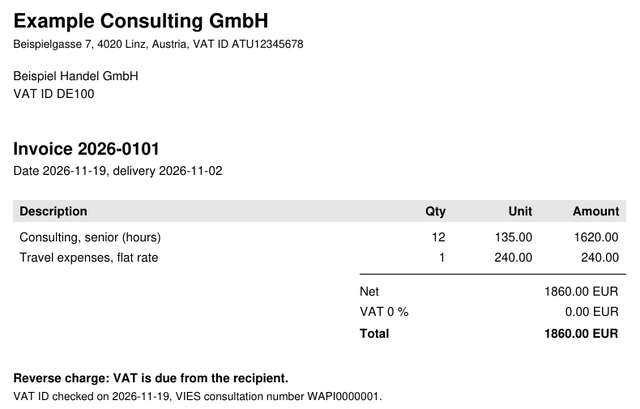

# Invoicing with web services: VAT, SOAP and GraphQL


Orders from a GraphQL API, EU VAT numbers checked with VIES over SOAP,
reverse charge, exact amounts, a PDF per invoice, and what to do when a
service is down.

Based on **Jennifer 0.26.0**, November 2026, by [@mplx](https://github.com/mplx).

<!-- notes:
One program, built step by step: an invented Austrian consultancy turns the
open orders of its shop into invoices. Business customers in other member
states get their VAT number checked first, because that decides whether the
invoice carries Austrian VAT or none at all. Every output on these slides is
from a real run of Jennifer 0.26.0, against the Commission's VIES test service
and a small stand-in GraphQL server written in Jennifer. Nothing here is tax
or legal advice.
-->

---

## The pipeline

| Step | Tool |
| --- | --- |
| Fetch open orders, page by page | `graphql` module |
| Check the customer's VAT number | `@deckyard/vies` over `soap` |
| Decide: domestic VAT, reverse charge, or hold | your code |
| Add up lines, VAT and total | `@deckyard/money` |
| Write the invoice | `pdf` module |
| Cache, retry, keep an audit trail | `flatdb`, `jsonl` |

Money basics: [Numbers and data](https://academy.jennifer-lang.dev/talks/mplx/numbers/).
PDF layout: [Making PDFs](https://academy.jennifer-lang.dev/talks/mplx/pdf-reports/).

<!-- notes:
graphql, soap, pdf, flatdb and jsonl ship with the interpreter. The two decks
come from the registry: jvc add @deckyard/vies and jvc add @deckyard/money,
then jvc update vendors them into the project. Exact arithmetic and rounding
modes were the topic of the numbers talk, and page layout with measured,
right-aligned columns was the PDF talk, so this one only shows what is new:
the web services, the tax decision and what can go wrong between them.
-->

---

## SOAP without a WSDL

The `soap` module reads no WSDL: take the namespace, the operation and
its parameters from the service's WSDL by hand.

```jennifer excerpt
def const NS as string init
    "urn:ec.europa.eu:taxud:vies:services:checkVat:types";
def op as xml.Value init soap.operation(NS, "checkVat",
    {"countryCode": "DE", "vatNumber": "100"}, true);
io.printf("%s\n", soap.envelope("1.1", [], [$op]));
```

```text
<soap:Envelope xmlns:soap="http://schemas.xmlsoap.org/soap/envelope/">
 <soap:Body><m:checkVat xmlns:m="urn:ec.europa.eu:taxud:...:types">
  <m:countryCode>DE</m:countryCode><m:vatNumber>100</m:vatNumber>
 </m:checkVat></soap:Body></soap:Envelope>
```

<!-- notes:
VIES, the European Commission's VAT Information Exchange System, is a SOAP 1.1
service. operation builds the element for one call; the last argument, true,
puts the parameters in the namespace too, as VIES's schema wants. envelope
wraps it; the module writes all of it on one line, which is indented and
shortened here to fit the slide. You rarely call envelope yourself: send and
call do it for you. It is useful to look at, or to queue a message.
-->

---

## Calling VIES by hand

```jennifer excerpt
def c as soap.Client init soap.withTimeout(soap.connect(TEST), 10000);
for (def n in ["100", "200", "300"]) {
    $op = soap.operation(NS, "checkVat",
        {"countryCode": "DE", "vatNumber": $n}, true);
    def r as soap.Reply init soap.send($c, "", $op);
    if ($r.isFault) {
        io.printf("%s HTTP %d fault %s: %s\n", $n, $r.status,
            $r.fault.code, $r.fault.reason);
    } else { ... soap.values($r.envelope.body[0]) ... }
}
```

```text
100 HTTP 200 checkVatResponse valid=true 2026-11-19+01:00
200 HTTP 200 checkVatResponse valid=false 2026-11-19+01:00
300 HTTP 200 fault Server: SERVICE_UNAVAILABLE
```

<!-- notes:
TEST is the Commission's test endpoint, checkVatTestService, which answers by
number: 100 is valid, 200 is invalid, and 201 to 601 each return one fault.
send returns a Reply whether or not it is a fault. values turns the answer
element into a map of its children by local name. Note the last line: VIES
sends its faults with HTTP 200, so the status alone tells you nothing. The
SOAPAction is empty, as VIES expects.
-->

---

## call: a fault is an error

```jennifer excerpt
def res as xml.Value init soap.call($c, "", $op);   # DE 100
io.printf("%s: %s\n", xml.localName($res), soap.values($res)["name"]);
try { soap.call($c, "", $op600); } catch (e) {
    if ($e.kind == soap.ERROR_KIND) {
        def se as soap.SoapError init $e;
        io.printf("%s\nstatus=%d isFault=%t code=%s\n", $se.message,
            $se.status, $se.isFault, $se.fault.code);
    }
}
```

```text
checkVatResponse: John Doe
soap: fault Server: MS_MAX_CONCURRENT_REQ
status=200 isFault=true code=Server
```

<!-- notes:
call is the short form: it returns the first element of the Body and throws a
SoapError on a fault. The error is a struct, so the fault's code, reason and
detail are fields to read, never text to parse. Assigning the caught value to
a variable of type soap.SoapError gives the checker its type. VIES puts its
own code into the fault's reason, so the SOAP code is just Server here. The
test service's trader is a placeholder called John Doe.
-->

---

## What @deckyard/vies adds

- Offline first: `parse`, `normalize`, `isWellFormed` per country
- Strict replies: the right element, echoing the number sent
- VIES's codes as `ViesError{code, transient, status}`
- Retries with backoff for transient faults and HTTP 503
- `checkApprox`: a consultation number as proof

```text
ATU 123.456-78   -> AT U12345678 well-formed=true
de 123 456 789   -> DE 123456789 well-formed=true
BE 417.497.106   -> BE 0417497106 well-formed=true
vies | vies: "12345678" is not a VAT number of AT
```

<!-- notes:
The deck is about 900 lines over soap.send. parse takes a number as a
customer types it, with spaces, dots and a prefix in any case, and returns
the country and number VIES wants; an old nine-digit Belgian number gets its
leading zero. A number that cannot belong to its country is refused before
any request, the last line, so a typo never costs a round trip. It caches
nothing, on purpose: a check is proof only for the day it was made.
-->

---

## check and checkApprox

```jennifer excerpt
def c as vies.Client init vies.sandboxClient();
for (def n in ["100", "200"]) {
    def r as vies.Result init vies.check($c, "DE", $n);
    io.printf("DE%s valid=%t name=[%s] date=%s\n", $r.number,
        $r.valid, $r.name, $r.requestDate);
}
def p as vies.ApproxResult init
    vies.checkApprox($c, "DE", "100", "AT", "U12345678");
io.printf("proof %s on %s\n", $p.requestIdentifier, $p.requestDate);
```

```text
DE100 valid=true name=[John Doe] date=2026-11-19+01:00
DE200 valid=false name=[] date=2026-11-19+01:00
proof WAPI0000001 on 2026-11-19+01:00
```

<!-- notes:
sandboxClient points at the test service and turns the country syntax check
and the retries off, because the test numbers are 100, 200 and so on. An
unknown number is an answer with valid false, not an error. checkApprox also
sends your own VAT number and returns a consultation number: keep it with the
invoice as evidence that you checked on that date. The deck refuses an answer
without one. In production, use vies.client().
-->

---

## When VIES says no, or not now

| Code | Meaning | `transient` |
| --- | --- | --- |
| `INVALID_INPUT` | unknown country, empty number | no |
| `VAT_BLOCKED`, `IP_BLOCKED` | number or caller blocked | no |
| `SERVICE_UNAVAILABLE` | VIES itself failed | yes |
| `MS_UNAVAILABLE` | the member state's register is down | yes |
| `TIMEOUT`, `*_MAX_CONCURRENT_REQ` | too slow, too busy | yes |
| (code `""`, status 503) | the maintenance page | yes |

```text
vies: checkVat DE300: SERVICE_UNAVAILABLE code=SERVICE_UNAVAILABLE
  transient=true status=200
```

<!-- notes:
Every error of kind vies is a ViesError, so its fields are safe to read once
the kind matches. transient means try again later: a member state's register
is often down at night for maintenance. The deck retries those itself, twice
by default, waiting one and then two seconds. After that, the answer is "we
do not know yet", which is very different from "this number is invalid".
Generic kinds pass through: timeout, closed, limit, and net.
-->

---

## What a valid VAT ID enables

In general, within the EU, for a supplier in one member state:

- **B2B services** to a business in another member state: taxed where the
  customer is, and the **customer** accounts for the VAT (reverse charge)
- **Goods** shipped to a business in another member state: exempt
  intra-Community supply; the buyer's valid VAT ID is a condition
- The invoice shows no VAT, **both** VAT IDs, and "Reverse charge"
- These sales go into the recapitulative statement (EC Sales List)
- No valid ID: often your own country's VAT, with many exceptions

Not legal advice: national rules, thresholds and exceptions apply.

<!-- notes:
These are the general rules of the EU VAT Directive: articles 44 and 196 for
business services, 138 for goods, 226 for what the invoice must say, 262 for
the recapitulative statement. A VIES answer shows that a number was valid on
that day; it does not show that this customer buys as a business, and
electronic services, events, land and distance sales of goods have rules of
their own. Ask your tax adviser before you write the decision into code.
-->

---

## The decision as code

```jennifer excerpt
func treatment(country as string, c as Check) {
    if ($country == SELLER_CC) {
        return Treatment{kind: "domestic", rate: VAT_RATE, ...};
    }
    if ($c.status == "valid") {
        return Treatment{kind: "reverse-charge", rate: "0", ...,
            note: "Reverse charge: VAT is due from the recipient."};
    }
    if ($c.status == "invalid") {
        return Treatment{kind: "no-valid-id", rate: VAT_RATE, ...};
    }
    return Treatment{kind: "held", rate: "", percent: "", note: ""};
}
```

<!-- notes:
Our seller sells consulting, a service under the general rule, from Austria,
where the standard rate is 20 percent, VAT_RATE "0.20". The important branch
is the last one: a check that could not be made gives neither reverse charge
nor domestic VAT, but a held invoice. Guessing either way is wrong for some
customers; waiting an hour for VIES costs nothing. Treatment is a struct of
kind, rate, the percent to print and the note; Check is our own struct,
filled from VIES or the cache, coming up later.
-->

---

## GraphQL: the query is a raw string

```jennifer excerpt
def const ORDERS as string init
'query Orders($first: Int!, $after: String) {
  orders(status: OPEN, first: $first, after: $after) {
    nodes { number date customer { name country vatId }
            lines { description qty unitPrice currency } }
    pageInfo { hasNextPage endCursor }
  }
}';
```

A `"..."` string interpolates `{...}`: GraphQL in one does not even parse.

```text
trap2.j: parse error at trap2.j:2:40: expected COLON after struct
  field name, got RBRACE ("}")
  def q as string init "{ viewer { login } }";
```

<!-- notes:
GraphQL is full of braces and dollar signs, and a cooked Jennifer string
treats every brace as interpolation. A raw single-quoted string takes them
literally, and may span lines. The 0.26.0 module docs show their queries in
double quotes; those examples do not run, which the next release fixes. The
graphql module never parses the document: it posts the text and the
variables, and returns the decoded answer.
-->

---

## Every page, until there is no next

```jennifer excerpt
while (true) {        # vars starts as {"first": 3}
    def conn as json.Value init json.get(
        graphql.query($gql, ORDERS, $vars), "/data/orders");
    # ... append each entry of /nodes to $nodes
    if (not json.asBool($conn, "/pageInfo/hasNextPage")) {
        return $nodes;
    }
    $vars = json.set($vars, "/after",
        json.asString($conn, "/pageInfo/endCursor"));
}
```

```text
Orders {"first":3}
Orders {"first":3,"after":"b3JkZXI6Mg=="}
Orders {"first":3,"after":"b3JkZXI6NQ=="}
```

<!-- notes:
Cursor pagination, the connection pattern most GraphQL APIs use: ask for the
first three, then for the three after the last cursor, until hasNextPage is
false. The output is the server's log: seven orders in three requests. The
client was built with graphql.bearer and the token from an environment
variable, and withTimeout. withRetries would retry a query answered 429 or
5xx; a mutation is never retried.
-->

---

## Errors arrive with HTTP 200

```jennifer excerpt
try { graphql.query($gql, ORDER, $vars); } catch (e) {
    if ($e.kind == "graphql") {
        def ge as graphql.GraphqlError init $e;
        io.printf("%s\n  reason=%s status=%d codes=%a\n", $ge.message,
            $ge.reason, $ge.status, $ge.codes);
    }
}
def resp as json.Value init graphql.tryQuery($gql, ORDER, $vars);
if (lists.contains(graphql.errorCodes($resp), "FORBIDDEN")) { ... }
```

```text
graphql: order 2026-0199 is not visible to this token [FORBIDDEN]
  reason=graphql status=200 codes=[FORBIDDEN]
data.order is null: true
graphql | graphql: HTTP 401: not authenticated [UNAUTHENTICATED]
```

<!-- notes:
In GraphQL a failed field is an HTTP 200 with an errors array, possibly next
to partial data. query throws a GraphqlError for that, with the codes from
each error's extensions. tryQuery returns the envelope instead, so you can
use the data that did arrive. A 401 that carries an errors envelope is read
the same way. One gap in 0.26.0: any JSON body with status 200 counts as a
success, even one without data; the next release checks the shape.
-->

---

## The amounts

```jennifer excerpt
# for each line $l of the order:
def unit as money.Money init money.parse(
    json.asString($l, "/unitPrice"), json.asString($l, "/currency"));
$lines[] = money.multiply($unit,
    io.sprintf("%d", json.asInt($l, "/qty")), "half-even");
# then, for the order:
def net as money.Money init money.sum($lines, "EUR");
def vat as money.Money init money.multiply($net, $t.rate, "half-up");
```

```text
2026-0101 DE reverse-charge net  1860.00 VAT    0.00 vies
2026-0102 AT domestic       net   810.00 VAT  162.00
2026-0103 FR no-valid-id    net   394.00 VAT   78.80 vies
2026-0104 NL held: VAT ID NL300 unverified (SERVICE_UNAVAILABLE)
```

<!-- notes:
Prices travel as strings in the API, "135.00", never as JSON floats, and
money.parse reads them strictly: a third decimal place for euros is an error.
The VAT is computed once on the net total and rounded half-up, which is a
choice the rules of your country make, as the numbers talk showed. The output
is the first run over the first four orders: the French customer's number is
invalid, and the Dutch one could not be checked, so that invoice is held.
-->

---

## On the invoice

```jennifer excerpt
$pg = pdf.text($pg, 50, 764, FONT, 9,
    SELLER_ADDR + ", VAT ID " + SELLER_CC + SELLER_VAT);
$pg = pdf.text($pg, 50, 700, FONT, 10, pdf.toWinAnsi(
    json.asString($order, "/customer/name"), "?"));
if ($c.vatId != "") {
    $pg = pdf.text($pg, 50, 686, FONT, 10, "VAT ID " + $c.vatId);
}
...
if ($t.note != "") {
    $pg = pdf.text($pg, 50, $y - 70, BOLD, 10, $t.note);
    $pg = pdf.text($pg, 50, $y - 84, FONT, 9, "VAT ID checked on "
        + $c.date + ", VIES consultation number " + $c.proof + ".");
}
```

<!-- notes:
The layout is the one from the PDF talk: standard fonts, measured text for
the right-aligned columns, a grey header bar. What matters here is content:
the seller's and the buyer's VAT IDs and the reverse charge note. Customer
names come from an API, so they go through toWinAnsi before drawing; one
character outside Windows-1252 would otherwise make the whole invoice throw.
Printing the consultation number is optional; keeping it is not.
-->

---

## The result



<!-- notes:
The top of invoice 2026-0101, rendered at 110 dpi with pdftoppm, with the
blank space above the address cut out. The German
customer's test number is valid, so the invoice shows zero VAT, both VAT IDs
and the note. The VAT ID DE100 is the test service's, and the seller's
ATU12345678 a placeholder; a real invoice also needs the customer's address,
the seller's company details and payment terms, which the full program in
the code folder leaves out to keep it short.
-->

---

## When VIES is down

```jennifer excerpt
def sb as vies.Client init
    vies.withRetries(vies.sandboxClient(), 2, 500);
attempt("service unavailable", $sb, "NL", "300");
attempt("no answer", vies.withTimeout(vies.withEndpoint($sb,
    "http://127.0.0.1:8098/slow"), 1000), "DE", "100");
```

```text
service unavailable: vies code=SERVICE_UNAVAILABLE transient=true
  status=200, 1917 ms
maintenance page: vies code= transient=true status=503, 1509 ms
no answer: timeout, 1001 ms
nobody listening: net, 1 ms
```

<!-- notes:
attempt is a small helper that calls check, catches and prints the kind. The
first case is the real test service, retried twice: 500 and then 1000
milliseconds of waiting. The others use a stand-in written in Jennifer that
answers 503 with an HTML page, or nothing at all; withEndpoint allows plain
http only on loopback. A timeout or an unreachable host is never retried by
the deck: a request that went out may have reached VIES.
-->

---

## Unverified is a result

```jennifer excerpt
try {
    def r as vies.ApproxResult init vies.checkApprox($vc,
        $id.country, $id.number, SELLER_CC, SELLER_VAT);
    # ... status "valid" or "invalid", proof = r.requestIdentifier
} catch (e) {
    if ($e.kind == vies.ERROR_KIND) {
        def ve as vies.ViesError init $e;
        if (not $ve.transient) { throw $e; }
        $c.detail = $ve.code;
    } elseif ($e.kind == "timeout" or $e.kind == "net") {
        $c.detail = $e.kind;          # "closed" too
    } else { throw $e; }
}
```

<!-- notes:
The Check starts as unverified and only a real answer changes it. Transient
faults, timeouts, closed connections and unreachable hosts all leave it
unverified, with the reason in detail. Everything else is thrown: a malformed
number or a blocked caller is a bug or a case for a human, not something to
wait out. A held invoice is simply not written yet; the next run, or the
re-check job two slides on, picks it up.
-->

---

## A cache that respects the rules

```jennifer excerpt
def db as flatdb.DB init flatdb.open(CACHE);
if (flatdb.has($db, $key)) {
    def hit as json.Value init flatdb.get($db, $key);
    if (json.asString($hit, "/date") == today()) { ... "cache" ... }
}
def c as Check init askVies($vc, $id);
audit($order, $c);
if ($c.status == "valid") {     # only a positive answer is cached
    $db = flatdb.set($db, $key, json.map({"date": $c.date,
        "proof": $c.proof}));
    $db = flatdb.save($db);
}
```

```text
{"DE100":{"date":"2026-11-19","proof":"WAPI0000001"}}
```

<!-- notes:
Three invoices for the same German customer need one VIES request, not
three. The cache keeps only valid answers, and only for the day they were
made, with their consultation number: an invalid number may be fixed by the
customer within the hour, and an unverified one must be asked again. How long
a check counts for you is a policy question; one day is a cautious answer.
flatdb saves atomically, through a temporary file and a rename.
-->

---

## The audit trail

```jennifer excerpt
jsonl.appendFile(AUDIT, [json.map({"at": time.iso(time.now()),
    "order": $order, "vatId": $c.vatId, "status": $c.status,
    "source": $c.source, "proof": $c.proof, "detail": $c.detail})]);
```

```text
{"order":"2026-0101","vatId":"DE100","status":"valid","source":"vies"}
{"order":"2026-0103","vatId":"FR200","status":"invalid","source":"vies"}
{"order":"2026-0104","vatId":"NL300","status":"unverified","source":"vies"}
{"order":"2026-0105","vatId":"DE100","status":"valid","source":"cache"}
2026-0104 NL300: still vies: checkVat NL300: SERVICE_UNAVAILABLE
  (after 2 retries)
```

<!-- notes:
Every decision leaves one JSON line: when, which order, which number, what
VIES or the cache said, and the proof. Append only, so nothing is rewritten.
The lines shown were cut down with jq to four fields; the file also has the
time, the proof and the detail, and the slide wraps the last line. The last line is recheck.j, which reads the log, takes
the latest record per VAT ID, and asks VIES again for the ones still
unverified. The test number 300 never recovers, by design.
-->

---

## Security, and two 0.26.0 gaps

- Tokens from the environment: `os.getEnv("SHOP_TOKEN")`, never in code
- Endpoints over `https://`; the deck allows `http://` only on loopback
- In 0.26.0, `soap` and `graphql` send an `Authorization` header over
  plain `http://` to any host; the next release refuses it without an
  explicit `allowInsecureHttp`
- In 0.26.0, `graphql` accepts any JSON 200 body as an answer: check
  that `/data` holds what you asked for
- Placeholders only: test numbers, invented companies, `demo-token`

<!-- notes:
Our stand-in shop runs on 127.0.0.1, so plain http and a bearer token are
fine there. Against a real API on another host, an http URL would put the
token on the wire in clear text, and 0.26.0 does not stop you. Reading a
missing path from the answer throws in the json library, which at least turns
a strange 200 body into an error rather than an empty invoice. Both gaps are
closed in the next release.
-->

---

## Read more

- Talks: [Numbers and data](https://academy.jennifer-lang.dev/talks/mplx/numbers/),
  [Making PDFs](https://academy.jennifer-lang.dev/talks/mplx/pdf-reports/)
- Decks: [@deckyard/vies](https://registry.jennifer-lang.dev/deck/deckyard/vies),
  [@deckyard/money](https://registry.jennifer-lang.dev/deck/deckyard/money)
- Module docs: `docs/modules/soap.md`, `graphql.md`, `flatdb.md`,
  `jsonl.md` in [jennifer-language/jennifer](https://github.com/jennifer-language/jennifer)
- The programs behind these slides: the `code/` folder of this talk

Based on Jennifer 0.26.0, November 2026.

<!-- notes:
The code folder has everything that ran for these slides: the invoicing
program, the GraphQL stand-in, the VIES outage stand-in, the re-check job and
the small demos. The deck manuals list every fault code and option. Three
habits to take home: unverified is a state, not an error to swallow; keep the
proof with the invoice; and let your tax adviser, not the code, decide the
rules the code follows.
-->
