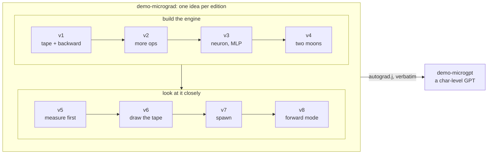
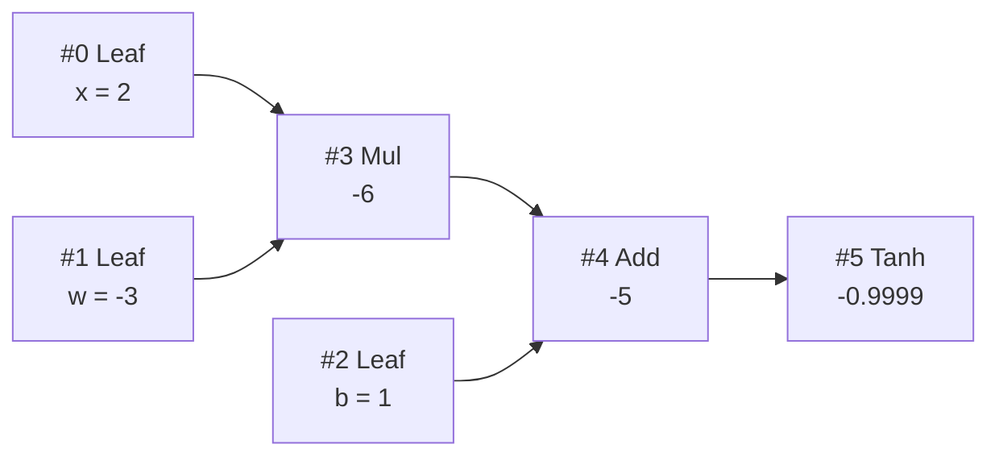
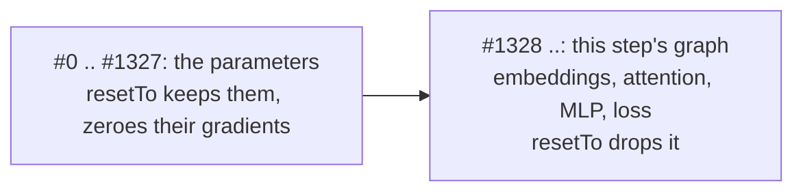
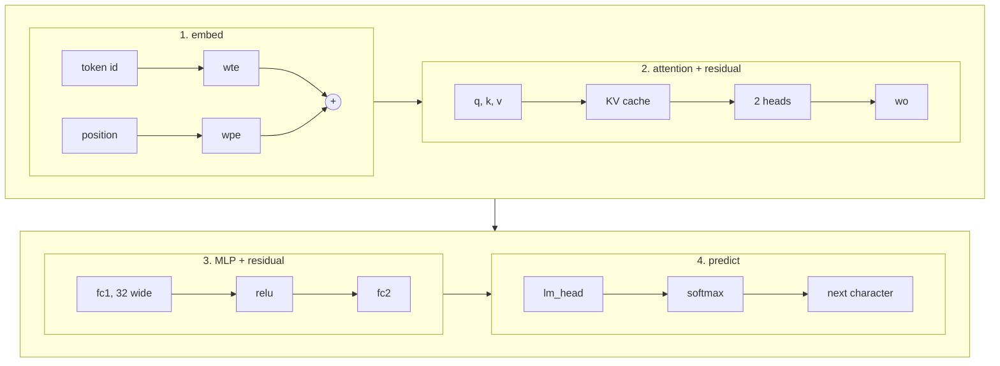
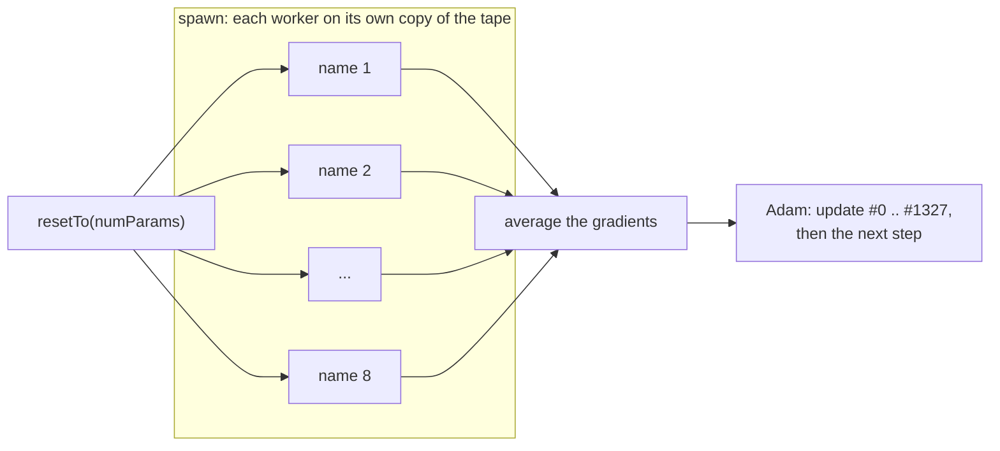
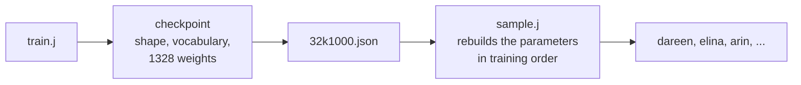

# The talk's diagrams

The Mermaid sources of the pictures on the slides. `render-diagrams.sh` draws
each block into the PNG named in the heading above it, beside `talk.md`.

## editions.png

## tape.png

## layout.png

## gpt.png

## training.png

## checkpoint.png

