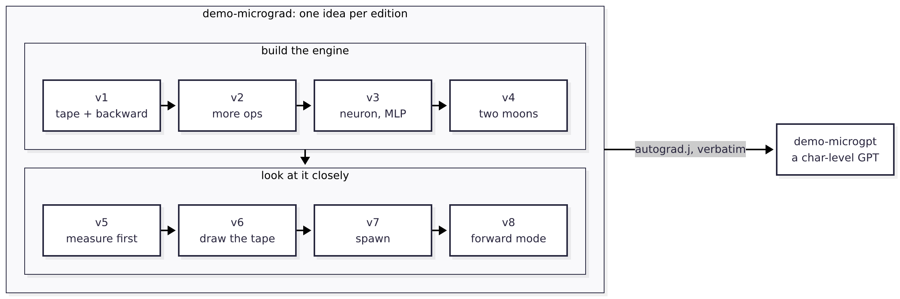
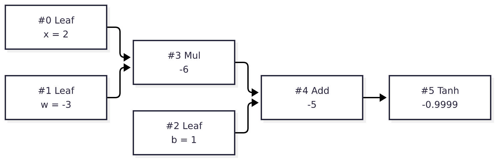
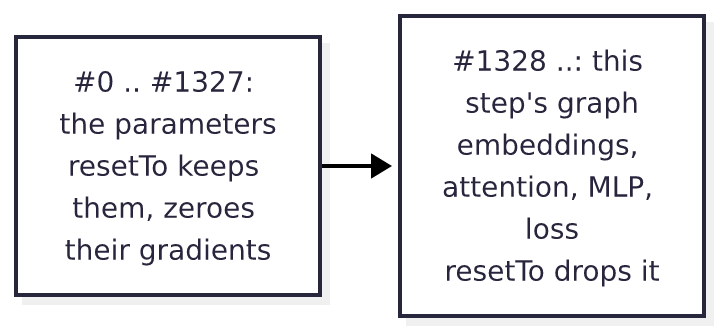
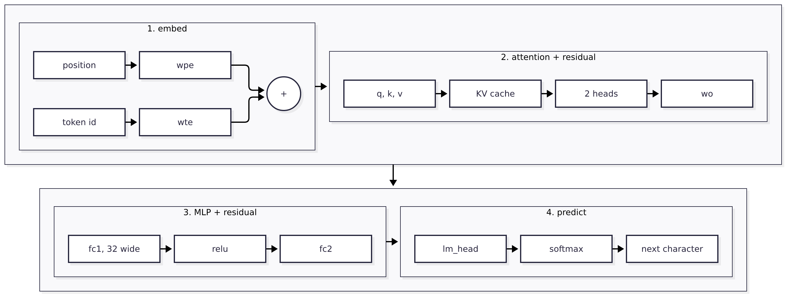
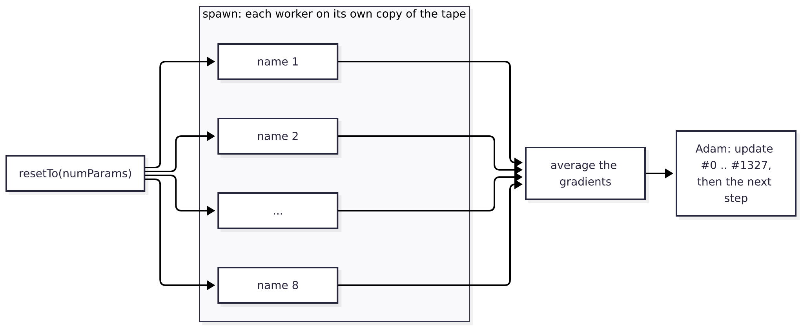
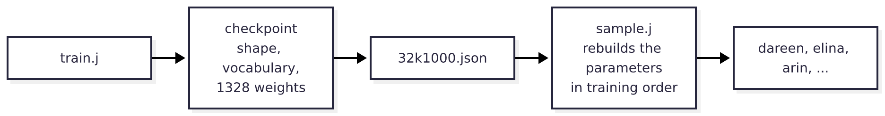

# Build your own GPT in Jennifer


From a scalar autodiff engine to a transformer that invents names: microGPT,
written from scratch, no libraries.

Based on **Jennifer 0.27.0**, November 2026, by [@mplx](https://github.com/mplx).

<!-- notes:
ChatGPT is a transformer trained to predict the next token. This talk builds
the same kind of model, just very small, in Jennifer, from the first line of
the autodiff engine to a trained model that makes up names. Nothing is
imported but the standard library. The goal is to understand every number
the model computes, not to compete with a real framework.
-->

---

## What we build

- **An autodiff engine:** every number a node on a tape, `backward` in one pass
- **A GPT:** embeddings, causal self-attention, an MLP, RMSNorm, softmax
- **Training:** Adam, data-parallel across all cores with `spawn`
- **A checkpoint:** train once, then sample as often as you like

1328 parameters, a 27-character vocabulary, trained on 32,033 names.

<!-- notes:
The model has the shape of GPT-2 but is tiny: an embedding width of 8, two
attention heads, one layer, a context of 16 characters. The tokens are single
letters, so the vocabulary is the alphabet plus one marker for the start and
end of a name. ChatGPT has billions of parameters and a tokenizer of words and
word pieces; the mechanics are the same.
-->

---

## Two repositories, read in order



<!-- notes:
demo-micrograd is the engine, in the spirit of Andrej Karpathy's micrograd,
written as eight editions. Each edition is a directory, and the diff from one
to the next is the lesson. demo-microgpt is a port of Karpathy's microGPT,
and its autograd.j is the engine from the eighth edition, copied verbatim.
So everything the model needs is explained before the model appears.
-->

---

## Every number is a node



`out = tanh(x * w + b)`: three leaves, three operations, six nodes.

<!-- notes:
Automatic differentiation means the program records how each value was made,
so it can later apply the chain rule backwards. Here a single neuron: x times
w, plus b, through tanh. Each box is one node, and the number in front of it
is its position on the tape. Gradients tell us how to nudge w and b to make
the output smaller or larger.
-->

---

## No closures, no shared objects

```jennifer excerpt
def enum Op { Leaf, Add, Sub, Mul, AddC, MulC, Tanh, Pow, Log, Exp, Relu };
def struct Node { data as float, grad as float, op as Op, a as int, b as int, c as float };
def tape as list of Node init [];
```

A node names its operands by **index** into one global `tape`.

<!-- notes:
In Python, micrograd gives each Value a closure that knows how to pass its
gradient back, and the graph is shared objects pointing at each other.
Jennifer has neither: no closures, and structs and lists are copied on
assignment. So a node stores an operation from an enum and the indices of its
operands. The constraint is what produces the design: an arena with integers
instead of pointers.
-->

---

## The tape is already sorted

- A node is appended **after** its operands
- So walking the tape from the end to the start is reverse-topological order
- `backward` needs no graph search and no sort, just one loop

```jennifer excerpt
$tape[$out].grad = 1.0;
def i as int init len($tape) - 1;
while ($i >= 0) {
    def n as Node init $tape[$i];
    # push n.grad to n.a and n.b by the chain rule
    $i = $i - 1;
}
```

<!-- notes:
This is the key trick of the arena. Every operation reads nodes that already
exist and appends a new one, so the indices are a valid topological order by
construction. When the walk reaches a node, all of its parents have already
added their share to its gradient. The neuron demo in the code folder prints
the tape and checks each gradient by hand.
-->

---

## One `match`, one rule per operation

```jennifer excerpt
match ($n.op) {
    when Mul {
        accum($n.a, $tape[$n.b].data * $n.grad);
        accum($n.b, $tape[$n.a].data * $n.grad);
    }
    when Tanh {
        # d/dx tanh(x) = 1 - tanh(x)^2, and n.data == tanh(operand)
        accum($n.a, (1.0 - $n.data * $n.data) * $n.grad);
    }
    # ... one branch per Op
}
```

<!-- notes:
The closure per node becomes one branch per operation. The match over the
enum is exhaustive, so adding an operation to Op without writing its backward
rule is a compile-time error, not a silent zero gradient. Multiplication sends
each operand the other operand's value times the incoming gradient. Tanh uses
its own output, which is already stored in the node.
-->

---

## Parameters lead the tape



`resetTo(numParams)` drops last step's graph and keeps the weights.

<!-- notes:
The model's weights are created first, so they occupy the first 1328
positions. A training step builds its whole graph after them, runs backward,
updates the weights, and then truncates the tape back to the parameters. If
anything ever appended a scratch node before the weights, resetTo would cut
into live parameters, so the engine's tests pin this layout down.
-->

---

## Measure before you optimize

- v5 profiled first, then changed three things: **16.7% faster**, same output
- Dropping the redundant zeroing pass: **-9.0%**
- Two optimizations everyone would predict measured at **zero**
- The numbers are in the edition's README, the misses included

<!-- notes:
The fifth edition is about honesty more than speed. The profiler showed that
backward zeroed all 2313 nodes on every call, although new nodes are born
with a zero gradient. Removing that was the biggest win. Reading node fields
without copying the struct, and native slices instead of a library call, both
measured exactly nothing, and the README says so instead of hiding it.
-->

---

## Forward mode: the other half

- v8 builds autodiff **without a tape**, with dual numbers `v + d*eps`
- One pass per **input**: a 200-weight neuron is 60x slower than reverse mode
- One pass per **output** for reverse mode: there forward mode wins by 500x
- Training has millions of inputs and one loss, so it is reverse mode

<!-- notes:
Forward mode carries the derivative along with each value, so it needs no
memory of the computation. The price is one full pass for every input you
want a derivative for. Reverse mode records the tape once and walks it back
once. The eighth edition measures both directions, and that measurement is
the reason the first seven editions, and every training framework, keep a tape.
-->

---

## From a neuron to a GPT



Each block also starts with an RMSNorm.

<!-- notes:
The model reads one character at a time. Its id and its position each select
a row of a learned table, and the two rows are added. Attention lets the
current character look at the earlier ones through the key and value cache.
The MLP transforms each position on its own. Both blocks add their input back,
the residual. The last layer scores all 27 characters.
-->

---

## Attention, one head

```jennifer excerpt
def t as int init 0;
while ($t < $steps) {                      # every earlier position
    def keyVec as list of int init $keysCache[$li][$t];
    def dotacc as int init mul($q[$hs], $keyVec[$hs]);
    # ... the rest of the dot product q . k
    $attnLogits[] = mulc($dotacc, $invSqrt);
    $t = $t + 1;
}
def weights as list of int init softmaxNodes($attnLogits);
```

From `attentionHead` in `model.inc.j`; then the weighted sum of the values.

<!-- notes:
Every value here is a list of node indices, not of numbers, so the whole
computation lands on the tape and backward can differentiate it. The query
of the current position is compared with the key of every earlier position,
scaled, and turned into weights by a softmax. Only earlier positions are in
the cache, which is what makes the attention causal.
-->

---

## The loss: guess the next letter

- A name is `<bos> e m m a <bos>`; each position predicts the next token
- Loss per position: `-ln p(correct next token)`, averaged over the name
- Adam updates the 1328 parameters from the averaged gradients
- The learning rate decays linearly to zero over the run

<!-- notes:
This is the same objective ChatGPT was pretrained with: predict the next
token. Here a token is a letter, and the beginning-of-sequence marker also
ends the name. A perfect model would assign probability one to every correct
next letter, giving a loss of zero. A model that guesses uniformly among 27
tokens has a loss of about 3.3.
-->

---

## Training on every core



<!-- notes:
A spawn in Jennifer deep-copies its enclosing scope, including the global
tape. So every worker builds its graph and runs backward on a private copy,
with no locks and no data race possible. The main task only averages the
returned gradients and applies Adam. Value semantics, the constraint that
forced the arena design, is what makes this parallelism safe.
-->

---

## What parallelism really bought

- microGPT: **about 3x** faster on 8 cores, at 450 to 490% CPU
- micrograd v7, a small MLP: capped at **about 1.4x**
- The scope copy is paid per `spawn`: more work per task, better speedup
- On `jennifer-tiny` the same code is **25x slower**: one thread, no parallelism

<!-- notes:
The copy that makes spawn safe is not free. In the seventh edition each
worker had little work, so copying the scope ate the gain. A transformer
forward and backward pass over one name is much more work, so the same idea
scales better there. The TinyGo build schedules cooperatively on one thread,
so measure on the binary you will ship.
-->

---

## Train once, sample often



A checkpoint is the shape, the vocabulary and the 1328 floats, read off the
front of the tape.

<!-- notes:
The graph is never saved, because it is rebuilt on every forward pass. What
defines the model is small: four integers for its shape, the characters of
the vocabulary, and the parameter values. Loading replays those floats through
the same construction order used in training, so the parameters land on the
same tape positions and the sampler gets exactly the trained model.
-->

---

## Run it

```sh
cd code
jennifer run neuron.j                                # the tape and its gradients
jennifer run sample.j --load 32k1000.json --samples 5
jennifer run train.j --steps 50 --batch 8 --save model.json
```

```text
sample 1: dareen
sample 2: elina
sample 3: arin
```

<!-- notes:
The code folder holds the engine, the model, the trainer and the sampler,
plus a checkpoint trained on the 32,033 names of the makemore data set. The
sampler starts in a fraction of a second. Training from scratch uses a small
built-in list of names unless you put an input.txt with one name per line
next to it.
-->

---

## What it is, and what it is not

- **It is:** every idea of a GPT, small enough to read in an afternoon
- **It is not:** fast. One node per scalar, interpreted, no tensors, no GPU
- **Bigger:** raise `NEMBD`, `NHEAD`, `NLAYER` in `model.inc.j`; time grows with the node count
- **Chat:** needs words as tokens, far more data, and instruction tuning on top

<!-- notes:
The point of a scalar engine is that you can print any number in the model
and follow it backwards. That clarity costs orders of magnitude in speed, so
use a real framework for real work. Turning a name generator into a chat
assistant is not a new algorithm: it is the same objective with a larger
model, a larger tokenizer, far more text and then fine-tuning.
-->

---

## Take it home

- [demo-micrograd](https://github.com/jennifer-language/demo-micrograd): the engine in eight editions; read the diffs
- [demo-microgpt](https://github.com/jennifer-language/demo-microgpt): the model, the trainer, the checkpoints
- The originals: micrograd and microGPT by [@karpathy](https://github.com/karpathy)
- Jennifer's constraints, no closures and value semantics, produced the design
- Measure every claim; write up the results that disappoint

<!-- notes:
Both projects reimplement Andrej Karpathy's work; his micrograd and microGPT
are the originals, and worth reading next to these ports. Start with the
first edition of demo-micrograd and read each diff; every edition opens by
saying what did not change. Then read model.j in
demo-microgpt with the engine in mind. The recurring lesson is that the
language's limits shaped a cleaner design, and that a performance claim
without a measurement, including the negative ones, is only a guess.
-->
