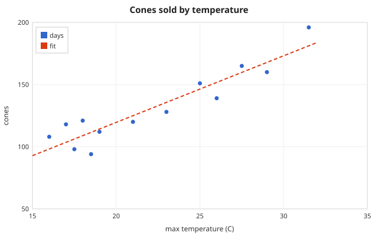
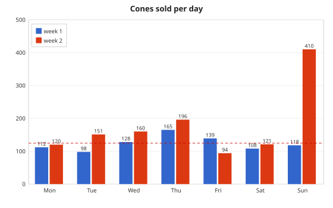
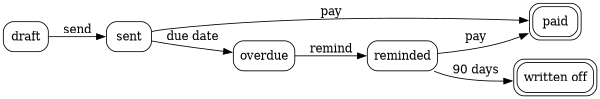

# Numbers and data in Jennifer


Money that adds up, statistics, a regression three ways, charts and graphs:
`decimal`, `intl`, `stats`, `linalg`, `ml`, `plot`, `dot` and the
`@deckyard/money` deck.

November 2026, by [@mplx](https://github.com/mplx).\
Based on **Jennifer 0.26.0**

<!-- notes:
The talk on CSV and spreadsheets ended with a float that printed as
38.400000000000006. This one starts there. It follows the numbers of a small
invented ice cream kiosk: first the money, done exactly with decimal and then
with the money deck, then the sales described with statistics, explained with
a regression, drawn as charts, and finally a graph of an invoice's life.
Everything but the money deck ships with the interpreter; every output on
these slides is from a real run of Jennifer 0.26.0.
-->

---

## The plan

| Question | Tool |
| --- | --- |
| Does the invoice add up to the cent? | `decimal`, `@deckyard/money` |
| How do I show it to a reader in Vienna? | `intl`, `printf` grouping |
| What does a normal day look like? | `stats` |
| How much does the weather sell? | `stats`, `linalg`, `ml` |
| Can I see it? | `plot` (SVG), `dot` (Graphviz™) |

Reading the data in is the [CSV and spreadsheets talk](https://academy.jennifer-lang.dev/talks/mplx/csv-sheets/).

<!-- notes:
All of these but one are built in. decimal, intl, stats, linalg and ml are
system libraries, enabled with use. plot and dot are modules written in
Jennifer itself, imported by file name. @deckyard/money is a deck from the
registry, vendored with jvc. None needs a network or an external program,
except Graphviz at the very end, which turns the text that dot writes into a
picture. How to get numbers out of a CSV file or a spreadsheet was the topic
of the previous talk, so here the data is simply written into the programs.
-->

---

## Floats cannot count money

```jennifer excerpt
io.printf("%v %t\n", 0.1 + 0.2, 0.1 + 0.2 == 0.3);
def net as float init 0.0;
for (def p in [19.99, 4.95, 0.35]) { $net = $net + $p * 3.0; }
io.printf("net %v, VAT %v\n", $net, $net * 0.2);
io.printf("%f|prec=2 %f|prec=2\n", 2.675, 1.005);
```

```text
0.30000000000000004 false
net 75.86999999999999, VAT 15.174
2.67 1.00
```

<!-- notes:
A float is binary. Most decimal fractions, 0.1 among them, have no exact
binary form, so they are stored as the nearest binary number and the errors
add up. Three items at three prices give a net that is a hair below 75.87.
Worse is rounding: 2.675 is really 2.67499 and something, so printing it with
two places rounds down, and 1.005 becomes 1.00. For measurements that is
noise; on an invoice it is a cent that an auditor will find.
-->

---

## decimal: exact, and you say when to round

```jennifer excerpt
def lines as list of decimal.Decimal init [];
for (def p in ["19.99", "4.95", "0.35"]) {
    $lines[] = decimal.mul($p, 3);
}
def net as decimal.Decimal init decimal.sum($lines);
def vat as decimal.Decimal init decimal.mul($net, "0.20");
io.printf("net %v, VAT %v -> %v\n", $net, $vat,
    decimal.round($vat, 2));
io.printf("%t\n", decimal.add("0.1", "0.2") == decimal.from("0.3"));
```

```text
net 75.87, VAT 15.1740 -> 15.17
true
```

<!-- notes:
A decimal.Decimal is an integer coefficient plus a scale, the number of
digits after the point. Addition and multiplication are exact; the scales of
a product add up, which is why the VAT shows four places until we round it.
Operands can be decimals, ints or decimal strings, so prices are written as
"19.99". Comparison with == compares values, so 1.0 equals 1.00, while the
scale is kept for display.
-->

---

## Rounding modes and division

```jennifer excerpt
for (def m in ["half-even", "half-up", "down"]) {
    io.printf("%s|pad=10 %v %v %v\n", $m,
        decimal.round("2.345", 2, $m), decimal.round("2.355", 2, $m),
        decimal.round("-2.345", 2, $m));
}
io.printf("%v %v\n", decimal.div(100, 8), decimal.div(100, 3, 2));
try { decimal.div(100, 3); } catch (e) { show($e); }
```

```text
half-even  2.34 2.36 -2.34
half-up    2.35 2.36 -2.35
down       2.34 2.35 -2.34
12.5 33.33
decimal: decimal.div: the quotient has no finite decimal form; pass
  a scale (and a rounding mode)
```

<!-- notes:
The default is half-even, banker's rounding: a tie goes to the even neighbour,
so rounding many amounts has no upward bias. Half-up is the school rule that
many tax offices prescribe. Seven modes exist; the table in the decimal docs
shows them all. Division is the one inexact operation: without a scale it
returns the exact quotient or throws an error of kind "decimal", so one third
never gets silently cut off. With a scale, you have decided.
-->

---

## Round per line, or on the total?

```jennifer excerpt
def lines as list of string init ["0.99", "0.99", "0.99"];
for (def n in $lines) {
    $perLine[] =
        decimal.round(decimal.mul($n, "0.19"), 2, "half-up");
}
def onTotal as decimal.Decimal init
    decimal.mul(decimal.sum($lines), "0.19");
def share as decimal.Decimal init decimal.div(100, 3, 2, "down");
def last as decimal.Decimal init
    decimal.sub(100, decimal.mul($share, 2));
```

```text
per line:  0.57
on total:  0.5643 -> 0.56
split 100: 33.33 + 33.33 + 33.34
```

<!-- notes:
Exact arithmetic does not decide where rounding belongs; the rules do. Three
items at 0.99 with 19 percent tax give 57 cents of tax when each line is
rounded and 56 cents when the total is. Both are correct for some country or
some contract, so the program has to state which. Splitting a bill is the
same question: round each share down and give the remainder to the last one,
so the parts always add up to the whole.
-->

---

## @deckyard/money: minor units and a code

```jennifer excerpt
def three as money.Money init
    money.multiply(money.parse("19.99", "EUR"), "3", "half-even");
io.printf("%v\n", $three);
io.printf("%t\n", money.add($three, money.fromMinor(3, "EUR"))
    == money.parse("60.00", "EUR"));
def gross as money.Money init
    money.multiply($three, "1.19", "half-up");
io.printf("%s EUR = %s JPY\n", money.format($gross), money.format(
    money.exchange($gross, "JPY", "162.345", "half-even")));
```

```text
money.Money{amount: 5997, currency: "EUR"}
true
71.36 EUR = 11585 JPY
```

<!-- notes:
For currency amounts there is a deck on top of decimal: jvc add
@deckyard/money, then import "@deckyard/money/" as money. A Money is an int
of minor units plus its ISO 4217 code, so 59.97 euros is 5997: exact, == just
works, and it stores as an integer column. The deck knows each currency's
places: 2 for EUR, 0 for JPY, 3 for KWD. multiply, divide and exchange take
the factor or rate as a decimal string and a rounding mode, with no default.
exchange rounds once, after moving between the two currencies' places. parse
is strict, "12.345" is refused for EUR, and format is its exact inverse.
-->

---

## money.allocate: no cent lost

```jennifer excerpt
def bill as money.Money init money.fromMinor(10000, "EUR");
def tip as money.Money init money.fromMinor(5, "EUR");
printParts(money.allocateTo($bill, 3));
printParts(money.allocate($bill, ["2", "1"]));
printParts(money.allocate($tip, ["0.7", "0.3"]));
def yen as money.Money init money.fromMinor(1200, "JPY");
try { money.add($bill, $yen); } catch (e) {
    io.printf("%s | %s\n", $e.kind, $e.message);
}
```

```text
33.34 + 33.33 + 33.33
66.67 + 33.33
0.04 + 0.01
money | money: different currencies: EUR and JPY
```

<!-- notes:
Two slides back we split 100 by hand: round down, give the rest to the last
share. allocate does that for you, by ratios given as decimal strings. Each
part gets its exact share rounded down, and the leftover cents go one each to
the parts that were cut the most, the earlier part on a tie, so here the first
guest pays 33.34. Five cents split 70 to 30 gives 4 and 1. printParts is a
small helper that formats and joins the parts. Amounts in different
currencies are simply not equal with ==, and adding, summing or comparing them throws an error of
kind "money": exchange is always a separate, explicit step.
-->

---

## Money for a reader: grouping and the mark

```jennifer excerpt
func money(d as decimal.Decimal, sep as string, mark as string) {
    def r as decimal.Decimal init decimal.round(decimal.abs($d), 2);
    def p as list of string init
        strings.split(decimal.toString($r), ".");
    def whole as string init io.sprintf("%d|group=3|sep={$sep}",
        convert.toInt($p[0]));
    def sign as string init "";
    if (decimal.sign($d) < 0) { $sign = "-"; }
    return $sign + $whole + $mark + $p[1];
}
```

```text
3.703,50 | 3,703.50
-1.234.567,00
```

<!-- notes:
Jennifer 0.26.0 has no locale-aware number formatting: the decimal and intl
docs both list it as an open question. What it has is digit grouping in
printf, group and sep on the %d verb, which allows the separators underscore,
comma, dot, dash and colon. That is enough for a small helper: round, split
off the fraction, group the whole part. Note the second line: minus
1234567.005 rounds half-even to .00. A space or an apostrophe as separator,
as in French or Swiss German, is not on the list. For currency amounts,
@deckyard/money is the deck to use; its format writes a plain 3703.50, so
pass money.toDecimal of the amount to a helper like this for display.
-->

---

## intl: the words around the number

```jennifer excerpt
intl.load("en", {"due": "Amount due: EUR %sum% (%n% items)"});
intl.load("de", {"due": "Zu zahlen: %sum% EUR (%n% Artikel)"});
for (def loc in ["de-AT", "en-GB", "nl"]) {
    intl.setLocale($loc);
    def m as list of string init $marks[$loc];
    def amount as string init money($sum, $m[0], $m[1]);
    io.printf("%s\n", intl.tr("due", {"sum": $amount, "n": 3}));
}
io.printf("%s\n", intl.tr("refund"));
```

```text
Zu zahlen: 3.703,50 EUR (3 Artikel)
Amount due: EUR 3,703.50 (3 items)
Amount due: EUR 3.703,50 (3 items)
refund
```

<!-- notes:
intl is a message catalog: load one map of keys to templates per language,
pick a locale, translate with named placeholders. The fallback chain goes from
de-AT to its base language de, then to the first language loaded, then to the
key itself, which is why Dutch gets the English sentence with a Dutch number,
and a missing key shows up as "refund" instead of an empty string. The marks
map holds each locale's separator and decimal mark for the helper.
-->

---

## stats: what a normal day looks like

```jennifer excerpt
def cones as list of int init [112, 98, 128, 165, 139, 108, 118,
    120, 151, 160, 196, 94, 121, 410];      # 14 days, one festival
io.printf("mean %f|prec=1, median %f|prec=1\n", stats.mean($cones),
    stats.median($cones));
io.printf("stddev %f|prec=1, sample %f|prec=1\n",
    stats.stddev($cones), stats.sampleStddev($cones));
io.printf("p90 %f|prec=1, IQR %f|prec=1, MAD %f|prec=1\n",
    stats.percentile($cones, 90), stats.iqr($cones),
    stats.mad($cones));
```

```text
mean 151.4, median 124.5
stddev 76.7, sample 79.6
p90 186.7, IQR 44.2, MAD 21.5
```

<!-- notes:
Fourteen days of cones sold. The last day was the town festival, 410 cones,
and it pulls the mean up from 131.5 to 151.4, while the median moves only
from 121 to 124.5. The
standard deviation suffers the same way; the interquartile range and the
median absolute deviation are the robust spreads. stddev divides by n, the
population form; sampleStddev divides by n minus 1. stats.describe returns
count, min, quartiles, mean, max and stddev in one struct.
-->

---

## Correlation and a straight line

```jennifer excerpt
# 13 ordinary days: max temperature (C) and cones sold
def temp as list of float init [19.0, 17.5, 23.0, 27.5, 26.0, 16.0,
    17.0, 21.0, 25.0, 29.0, 31.5, 18.5, 18.0];
io.printf("r = %f|prec=3\n", stats.correlation($temp, $cones));
def fit as stats.Regression init
    stats.linearRegression($temp, $cones);
io.printf("cones = %f|prec=2 * temp %f|prec=2|sign=always\n",
    $fit.slope, $fit.intercept);
io.printf("r2 %f|prec=3, slope p %f|prec=1|sci=true\n", $fit.r2,
    $fit.pValue);
```

```text
r = 0.930
cones = 5.36 * temp +12.44
r2 0.865, slope p 4.1e-06
```

<!-- notes:
Without the festival, how much does the weather explain? The Pearson
correlation is 0.93. linearRegression fits the least-squares line and returns
a struct: every degree sells about five more cones, the line explains 87
percent of the variance, and the p-value says a slope that steep is very
unlikely by chance. stats also has confidence intervals, t-tests, ANOVA and
the distributions they rest on.
-->

---

## The same fit with linalg

```jennifer excerpt
def X as list of list of float init [];
for (def t in $temp) { $X[] = [1.0, $t]; }      # a column of ones
def Xt as list of list of float init linalg.transpose($X);
def beta as list of float init linalg.solve(linalg.matmul($Xt, $X),
    linalg.matmul($Xt, $cones));
io.printf("intercept %f|prec=2, slope %f|prec=2\n", $beta[0],
    $beta[1]);
def res as list of float init
    linalg.sub($cones, linalg.matmul($X, $beta));
io.printf("residual norm %f|prec=1\n", linalg.norm($res));
```

```text
intercept 12.44, slope 5.36
residual norm 37.5
```

<!-- notes:
Least squares is the solution of the normal equations: X transposed times X,
times beta, equals X transposed times y. A matrix in linalg is just a list of
lists of float, so the design matrix is built with a loop, one row per day:
a one for the intercept and the temperature. solve throws on a singular
system instead of returning garbage. The numbers match stats exactly. Note
that squaring the matrix squares its condition number: fine here, not for
nearly collinear columns.
-->

---

## ml: a second feature, and a forecast

```jennifer excerpt
# [temperature, weekend 0/1] per day
def X as list of list of float init [[19.0, 0.0], [17.5, 0.0], ...];
def m as ml.Model init ml.linearRegression($X, $y);
io.printf("coef %a|prec=2, intercept %f|prec=2\n",
    ml.coefficients($m), ml.intercept($m));
def fit as list of float init ml.predict($m, $X);
io.printf("r2 %f|prec=3, rmse %f|prec=1\n", ml.r2($y, $fit),
    ml.rmse($y, $fit));
io.printf("Saturday, 30 C: %a|prec=0\n",
    ml.predict($m, [[30.0, 1.0]]));
```

```text
coef [6.55, 23.92], intercept -19.63
r2 0.949, rmse 6.4
Saturday, 30 C: [201]
```

<!-- notes:
ml follows the fit and predict shape of scikit-learn: a fit function returns
an opaque model, predict applies it. With the weekend as a second feature,
the model finds about 24 extra cones on a Saturday or Sunday, and the
explained variance rises from 0.87 to 0.95. The error metrics are plain
functions over two lists. ridge and lasso regularise the same fit, and
polynomialFeatures and trainTestSplit help with the rest of the workflow.
-->

---

## ml: clusters, then neighbours

```jennifer excerpt
# [average basket in EUR, visits per month] for eight customers
def X as list of list of float init [[4.2, 22.0], [3.8, 25.0], ...];
math.randSeed(7);
def scaler as ml.Model init ml.standardScaler($X);
def Z as list of list of float init ml.transform($scaler, $X);
def km as ml.Model init ml.kMeans($Z, 3);
io.printf("clusters %a\n", ml.predict($km, $Z));
def nb as ml.Model init ml.kNN($Z, ml.predict($km, $Z), 3);
io.printf("new customer -> %a\n",
    ml.predict($nb, ml.transform($scaler, [[17.0, 5.0]])));
```

```text
clusters [1, 1, 1, 0, 0, 0, 2, 2]
new customer -> [0]
```

<!-- notes:
Eight loyalty card customers: regulars with small baskets, rare big
shoppers, and two in between. The features have different units, so a
standard scaler puts them on one scale before k-means groups them. k-means
starts from random centres, and math.randSeed makes the run repeatable. The
cluster numbers are labels without meaning. A k-nearest-neighbour classifier
trained on them then places a new customer: a big, rare shopper.
-->

---

## plot: a chart as an SVG string

```jennifer excerpt
def opts as plot.Options init plot.defaults();
$opts.title = "Cones sold by temperature";
$opts.legendPos = "top-left";
def days as plot.Series init plot.points("days", $temp, $cones);
def line as plot.Series init plot.series("fit", $xs, $ys);
$line.dash = true;
plot.save(plot.chart([$days, $line], $opts), "cones.svg");
```

```text
$ rsvg-convert -w 640 cones.svg -o cones.png
```

<!-- notes:
plot is a module, imported with import "plot.j" as plot. Options and Series
are structs: start from the defaults and set fields. chart draws several
series on shared axes; here the days as points and the fitted line, computed
at two temperatures from the regression's slope and intercept, dashed. The
result is a complete SVG document as a string. Browsers show it directly;
for these slides it was converted to PNG with rsvg-convert.
-->

---

## The chart



<!-- notes:
This is the file the program wrote, converted without any editing. The axis
labels were set with xLabel and yLabel. The points scatter around the line by
about the residual we computed, and the three days above the line on the left
are weekend days, which is what the second feature in the ml model picked up.
Every mark carries a native hover tooltip in the SVG.
-->

---

## Bars, grouped

```jennifer excerpt
$opts.barLabels = true;
$opts.refLines = [plot.hline(124.5, "")];
plot.save(plot.bars($days, [$w1, $w2], $opts), "week.svg");
```



<!-- notes:
bars takes category labels, here Mon to Sun, and a list of series, one per
week, built with plot.series and empty x values: a bar series uses only its
y values. barMode chooses grouped or stacked. The dashed line is the median
from the stats slide, which makes the festival Sunday impossible to miss.
In 0.26.0 plot accepts an unknown option value such as a misspelt legendPos
without complaint; the next release throws a "plot" error for it.
-->

---

## dot: a graph from data

```jennifer excerpt
def steps as list of list of string init [
    ["draft", "send", "sent"], ["sent", "pay", "paid"],
    ["sent", "due date", "overdue"],
    ["overdue", "remind", "reminded"], ["reminded", "pay", "paid"],
    ["reminded", "90 days", "written off"]];
def g as dot.Graph init dot.digraph("invoice");
$g = dot.graphAttr($g, "rankdir", "LR");
for (def t in $steps) {
    $g = dot.edgeWith($g, $t[0], $t[2], {"label": $t[1]});
}
io.printf("%s", dot.render($g));
```



<!-- notes:
The life of an invoice as a list of transitions: from, event, to. dot builds
a Graph value, every builder returns a new one, and render writes Graphviz's
DOT text with every name and label quoted and escaped. Layout is not
Jennifer's job: jennifer run invoice.j piped into dot -Tpng drew this
picture. The full program also gives the two final states a double border
with nodeWith, and rounded boxes with nodeAttr. In 0.26.0 render does not reject control
characters in labels; the next release does.
-->

---

## Strict at the boundaries

```jennifer excerpt
def big as int init 9223372036854775807;
try { io.printf("%d\n", $big + 1); } catch (e) { show($e); }
try { io.printf("%v\n", 1e308 * 10.0); } catch (e) { show($e); }
try { io.printf("%v\n", math.sqrt(-1.0)); } catch (e) { show($e); }
try { io.printf("%v\n", stats.mean([])); } catch (e) { show($e); }
io.printf("%v\n", decimal.pow(2, 64));
```

```text
runtime: integer overflow: 9223372036854775807 + 1
runtime: float overflow: 1e+308 * 10 produced a non-finite result
runtime: sqrt(): undefined for negative input -1.0
runtime: stats.mean: list is empty
18446744073709551616
```

<!-- notes:
An int never wraps around and a float never becomes infinity or NaN: both are
errors you can catch, and NaN does not exist in Jennifer at all. stats,
linalg and ml follow the same rule for empty lists, singular matrices and
constant columns. Beyond the int range, a decimal with scale zero is the big
integer. Passing a float to decimal.mul is refused at run time, and jennifer
lint already reports it as L110.
-->

---

## When to reach for which

| You have | Use |
| --- | --- |
| exact sums, tax rates, fixed places | `decimal` |
| currency amounts, splits, FX | `@deckyard/money` |
| measurements and ratios | `float`, `math` |
| a column to summarise or test | `stats` |
| a fit, a forecast, clusters | `linalg`, `ml` |
| a chart or a diagram | `plot`, `dot` |

<!-- notes:
Text around a number, in the reader's language, is intl.tr plus a format
helper like the one earlier; round decimal values explicitly before you show
them. linalg solves equations and distances and does the least-squares fit
by hand; ml fits and predicts, clusters and scores. plot draws charts for a
report or a web page; dot turns data into boxes and arrows for Graphviz.
The short version. Money is never a float. decimal is exact arithmetic in
general; an amount in a currency belongs in @deckyard/money, which keeps the
code with it and splits without losing a cent. Measurements usually are
floats, and 75.86999 is fine as long as you format it for people. stats answers
questions about one or two columns, linalg is the toolbox underneath, ml
wraps the common models in fit and predict. plot and dot turn the answers
into pictures that a report, a web page or a slide can carry.
-->

---

## Read more

- Library docs in the [Jennifer repository](https://github.com/jennifer-language/jennifer):
  `docs/libraries/decimal.md`, `intl.md`, `stats.md`, `linalg.md`, `ml.md`
- Module docs: `docs/modules/plot.md`, `docs/modules/dot.md`
- The money deck: [@deckyard/money](https://registry.jennifer-lang.dev/deck/deckyard/money)
- Before this talk: [CSV and spreadsheets](https://academy.jennifer-lang.dev/talks/mplx/csv-sheets/)
- More talks: the [Jennifer Academy](https://academy.jennifer-lang.dev/)

Based on Jennifer 0.26.0, November 2026.

<!-- notes:
The decimal page has the full table of rounding modes and the limits on digit
counts. The stats page lists every distribution and test; the ml page lists
each model's parameters and caps. The examples directory of the interpreter
repository has runnable demos for plot and dot; the money deck's registry
page links its manual. Take home three habits: keep money in decimal or the
money deck, round where the rules say, and let a picture be generated
from the same data as the numbers.
-->
