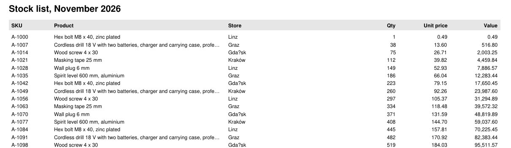

# Making PDFs with Jennifer


A multi-page table report with the stdlib `pdf` module: fonts, measuring,
right-aligned numbers, clipped columns, page breaks and "Page x of y".

Based on **Jennifer 0.26.0**, November 2026, by [@mplx](https://github.com/mplx).

<!-- notes:
We build one real program: a stock list of 130 articles, printed on A4
landscape in an 8 point font, with a header row that repeats on every page and
a footer that says "Page 2 of 4". Along the way we meet every part of the pdf
module a report needs. Every output and picture in this talk comes from running
that program with Jennifer 0.26.0; nothing is mocked up.
-->

---

## The pdf module in one slide

- `import "pdf.j" as pdf;` ships with the interpreter, pure Jennifer
- A **writer**: builds pages, renders them to `bytes`; it reads no PDFs
- Units are **points** (1/72 inch), origin **bottom left**, y grows upward
- Coordinates and sizes are `int`; colours are RGB `0-255`

| Paper | Width x height |
| --- | --- |
| A4 portrait | 595 x 842 |
| A4 landscape | 842 x 595 |
| US Letter | 612 x 792 |

<!-- notes:
The module is written in Jennifer itself and runs on both interpreter binaries,
the default one and jennifer-tiny. It writes the PDF structure by hand and
compresses each page's content stream. The one thing to get used to is the
coordinate system: y counts from the bottom of the page, so a report that runs
downward makes y smaller with every row. Landscape is not a flag; you simply
swap width and height.
-->

---

## Hello, PDF

```jennifer
import "pdf.j" as pdf;
use fs;

def pg as pdf.Page init pdf.page(842, 595); # A4 landscape
$pg = pdf.text($pg, 40, 540, "Helvetica-Bold", 20, "Stock list");
$pg = pdf.color($pg, 0, 90, 160);
$pg = pdf.line($pg, 40, 530, 802, 530);
$pg = pdf.rect($pg, 40, 470, 200, 40, false); # false: outline only

def doc as pdf.Document init pdf.addPage(pdf.document(), $pg);
$doc = pdf.info($doc, "Title", "Stock list");
fs.writeBytes("hello.pdf", pdf.render($doc));
```

<!-- notes:
Every builder returns a new value and never changes its argument, the normal
value semantics of Jennifer, so you thread the page through: $pg = pdf.text of
$pg. A colour set with pdf.color applies to everything drawn after it on that
page, fill and stroke alike, so the order of calls matters. rect takes a
filled flag. render returns the finished file as bytes, which fs.writeBytes
saves, an HTTP handler returns, or mime attaches to an email.
-->

---

## Fonts and measuring

- Text takes one of the **standard 14** fonts every viewer has:
  `Helvetica`, `Times-Roman`, `Courier`, their Bold / Italic (Oblique)
  forms, `Symbol`, `ZapfDingbats`
- Anything else throws: `pdf: unknown font 'Arial' (use a standard-14 base font)`
- `pdf.measureText(font, size, str)` returns the width in points, a `float`

```jennifer excerpt
pdf.measureText("Helvetica", 8, "Hello")   # 18.224
pdf.measureText("Helvetica", 8, "...")     # 6.672
pdf.measureText("Helvetica", 8, "…")       # 8.0
```

<!-- notes:
The standard fonts are not embedded in the file; the viewer brings them, which
keeps a report of several pages under ten kilobytes. measureText uses the
Adobe metrics of each font, so the width it reports is the width you see.
Everything that follows, right alignment and clipping, is built on that one
function. The single ellipsis character is a real glyph in these fonts, a bit
wider than three dots at this size.
-->

---

## What we are building



<!-- notes:
This is the top of page one at 110 dpi. A title, a grey header bar, and then
rows in 8 point Helvetica, 12 points apart. Long product names end in an
ellipsis instead of running into the store column. Numbers are right-aligned
with thousands separators, so the columns of digits line up. "Gda?sk" is not a
typo: it is how the report shows a character the standard fonts cannot encode,
which we come to near the end.
-->

---

## The layout as constants

```jennifer excerpt
def const PAGE_W as int init 842;   # A4 landscape
def const PAGE_H as int init 595;
def const MARGIN as int init 40;
def const RIGHT as int init 802;    # PAGE_W - MARGIN
def const FONT as string init "Helvetica";
def const BOLD as string init "Helvetica-Bold";
def const SIZE as int init 8;
def const ROW as int init 12;       # baseline to baseline
def const TOP as int init 520;      # first row's baseline
def const BOTTOM as int init 60;    # keep clear for the footer
def const TITLE as string init "Stock list, November 2026";
```

38 rows fit between `TOP` and `BOTTOM`: 130 rows make 4 pages.

<!-- notes:
A report is a grid, and the grid is a handful of numbers. Writing them down as
constants keeps the drawing code free of magic values and makes the page easy
to change: a smaller font is SIZE and ROW, portrait paper is the first two
lines. The row height is a little more than the font size, which leaves the
small gap between lines that makes a dense table readable.
-->

---

## Right-aligned numbers

```jennifer excerpt
func width(font as string, s as string) {
    return math.ceil(pdf.measureText($font, SIZE, $s));
}
func rightText(pg as pdf.Page, right as int, y as int,
        font as string, s as string) {
    def x as int init $right - width($font, $s);
    return pdf.text($pg, $x, $y, $font, SIZE, $s);
}
func money(cents as int) {   # 1765045 gives "17,650.45"
    return io.sprintf("%d|group=3|sep=,.%d|pad=2|fill=0",
        $cents // 100, $cents % 100);
}
```

<!-- notes:
text places the start of a string, so to end it at a column's right edge we
start it at the edge minus its width. math.ceil turns the float width into the
int the page wants. Money is kept in cents, as an int, so no rounding ever
creeps in; the formatter groups the whole part by three with a comma and pads
the cents to two digits. Remember that // is integer division in Jennifer and
a single slash would give a float.
-->

---

## Clipping a column with an ellipsis

```jennifer excerpt
func clip(s as string, max as int) {
    if (width(FONT, $s) <= $max) {
        return $s;
    }
    def cut as string init $s;
    while (len($cut) > 0 and width(FONT, $cut + "…") > $max) {
        $cut = $cut[..len($cut) - 1];
    }
    return $cut + "…";
}
```

```text
Cordless drill 18 V with two batteries, charger and carrying case, profe…
```

<!-- notes:
PDF text never wraps or stops by itself: a long string simply runs over the
next column. So each cell is clipped to its column, 260 points for the product
name. The loop drops one character at a time until the text plus the ellipsis
fits. A string slice takes characters, not bytes, so an accented name is never
cut in half. For text that should wrap instead, the module has wrapText and
textBlock, which we touch at the end.
-->

---

## A page with its header

```jennifer excerpt
def struct Cursor { page as pdf.Page, y as int };

func newPage() {
    def pg as pdf.Page init pdf.page(PAGE_W, PAGE_H);
    $pg = pdf.text($pg, MARGIN, 550, BOLD, 14, TITLE);
    $pg = pdf.color($pg, 230, 230, 230);
    $pg = pdf.rect($pg, MARGIN, TOP + 2, RIGHT - MARGIN, 16, true);
    $pg = pdf.color($pg, 0, 0, 0);
    $pg = pdf.text($pg, 110, TOP + 6, BOLD, SIZE, "Product");
    $pg = rightText($pg, 640, TOP + 6, BOLD, "Qty");
    # ... the other four column titles
    return Cursor{page: $pg, y: TOP};
}
```

<!-- notes:
The header repeats on every page because every page starts in this one
function. It draws the title, a filled grey bar, then switches back to black
before the column titles, because the colour stays set until it is changed.
The numeric column titles are right-aligned with the same helper as the
numbers below them. The Cursor bundles the page with the y of the last row
drawn, so one value moves through the loop.
-->

---

## Rows and page breaks

```jennifer excerpt
def pages as list of pdf.Page init [];
def c as Cursor init newPage();
for (def it in $items) {
    if ($c.y - ROW < BOTTOM) {          # the next row would not fit
        $pages[] = $c.page;
        $c = newPage();
    }
    $c = row($c, $it);                  # draws one row, y - ROW
}
$pages[] = $c.page;
```

```text
130 rows on 4 pages
```

<!-- notes:
Before each row we ask whether it would still land above the bottom margin. If
not, the finished page goes into a list and a fresh one, with its header,
takes its place. The row function draws six cells at y minus ROW and returns
the cursor moved down. After the loop the last, partly filled page is added
too; forgetting that line is the classic bug that loses the final rows.
-->

---

## "Page x of y": the second pass

The total is known only after the last row, so footers come after the loop:

```jennifer excerpt
func footer(pg as pdf.Page, n as int, total as int) {
    def out as pdf.Page init pdf.line($pg, MARGIN, 45, RIGHT, 45);
    $out = pdf.text($out, MARGIN, 32, FONT, SIZE,
        "Example Hardware Ltd.");
    return rightText($out, RIGHT, 32, FONT, "Page {$n} of {$total}");
}

def done as list of pdf.Page init [];
for (def i in 0..len($pages)) {
    $done[] = footer($pages[$i], $i + 1, len($pages));
}
$doc = pdf.addPages($doc, $done);
```

<!-- notes:
Page three cannot say "of 4" while page four does not exist yet. Because the
pages are plain values in a list, the answer is a second pass: keep them all,
then draw each footer once the count is known. This is also the place for
anything else per page, such as a different text on the last page. addPages
appends the whole list in one copy, where addPage in a loop would copy the
document once per page.
-->

---

## Or let the module stamp it

```jennifer excerpt
def f as pdf.PageLabel init pdf.pageLabel();
$f.left = "Example Hardware Ltd.";
$f.right = "Page %page% of %pages%";
$f.border = true;
$doc = pdf.setFooter($doc, $f);   # also setHeader
```

```text
Example Hardware Ltd.   Page 1 of 2
Example Hardware Ltd.   Page 2 of 2
```

<!-- notes:
For the common case the module does the second pass for you. A PageLabel has a
left, a centre and a right slot, and render replaces %page% and %pages% on
every page, when the total is known. The placeholders use percent signs so
they do not clash with Jennifer's own braces in strings. The output shown is
pdftotext reading back a two-page test. Anything beyond the two placeholders
needs the hand-made pass from the previous slide.
-->

---

## The limit: WinAnsi

The standard fonts encode **Windows-1252** only: Western European text.

```jennifer excerpt
pdf.text($pg, 110, 500, FONT, SIZE, "Gda\u0144sk");   # throws:
# encoding.encode (windows-1252): rune U+0144 ... does not map
pdf.toWinAnsi("Gda\u0144sk \u2192 Kraków", "?")
# gives "Gda?sk ? Kraków"
```

- Run **every** text from data through `toWinAnsi` first
- Need Polish, Greek, Cyrillic, CJK? `loadFont` + `addFont` +
  `textUnicode` with a TrueType font, measured by `measureTextUnicode`

<!-- notes:
ä, ö, é, ß, the euro sign and typographic quotes are all fine. One character
outside the set, a Polish n with an accent in a store name, makes text throw,
and the whole report fails because of one row. toWinAnsi replaces what cannot
be shown, here with a question mark, and returns a clean string unchanged.
For real multilingual output, embed a TrueType font: the whole file goes into
the PDF, which costs size but shows every script the font covers.
-->

---

## Metadata, bookmarks, same bytes

```jennifer excerpt
$doc = pdf.info($doc, "Title", "Stock list, November 2026");
$doc = pdf.info($doc, "Author", "Warehouse team");
$doc = pdf.info($doc, "CreationDate", pdf.pdfDate(time.utc()));
$doc = pdf.bookmark($doc, 0, 550, "Linz", 1); # page from 0
```

- `render` writes **no timestamp** of its own: same input, same bytes
- Our report: 4 pages, 8,776 bytes, `qpdf --check` finds no errors

<!-- notes:
Info entries are what a viewer shows under document properties; they are not
limited to WinAnsi, because the viewer reads them rather than a font. A
bookmark adds an entry to the sidebar that jumps to a page and height, nested
by level. Because nothing varies with the clock unless you ask for a date, two
runs give identical files: a test can compare the output with a stored golden
file byte for byte. We checked that by running the report twice.
-->

---

## When pages get busy

```jennifer excerpt
def ops as list of pdf.DrawOp init [];
for (def r in $rows) {
    $ops[] = pdf.DrawOp.Text{x: 44, y: $r.y, font: FONT,
        size: SIZE, str: $r.sku};
}
$pg = pdf.draw($pg, $ops);
```

- Each `pdf.text` call appends to the page's content: thousands of calls
  per page grow as n squared; `draw` joins them once
- `wrapText` and `textBlock(pg, x, y, width, font, size, leading, str, align)`
  for paragraphs; `drawImage` for a logo

<!-- notes:
Our pages hold about 230 drawing calls each and the whole report runs in well
under a second, so the simple form is right here. A page with thousands of
elements, a dense chart or a long log, should collect DrawOp values and apply
them with one draw call, which gives byte-identical output. For notes or terms
under a table, textBlock wraps and aligns a paragraph into a column, left,
right, centred or justified.
-->

---

## Read more

- The module reference: [pdf on docs.jennifer-lang.dev](https://docs.jennifer-lang.dev/modules/pdf.html)
- The interpreter and its modules: [jennifer-language/jennifer](https://github.com/jennifer-language/jennifer)
- Slides and books built on this module: cantrip and Grimoire, in the
  [Jennifer Academy](https://academy.jennifer-lang.dev/)

Based on Jennifer 0.26.0, November 2026.

<!-- notes:
The reference page lists every function with its parameters, including the
image and embedded-font parts this talk only mentioned. The best larger
examples are two tools built on the module: cantrip, which made the PDF of
these slides, and Grimoire, which prints whole manuals with bookmarks and page
numbers. Both are free to read, and both are covered by talks of their own.
-->
