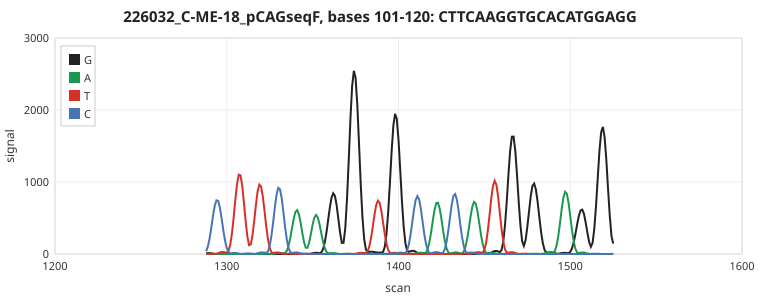
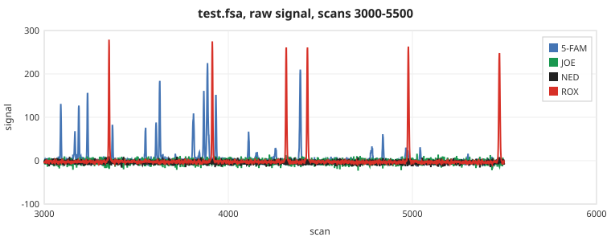

# Sequencing data with Jennifer


Sequences, Sanger traces, fragment runs, NGS reads, mtDNA haplogroups and
study tables with five `@deckyard` decks, and one pipeline that ties them
together.

November 2026, by [@mplx](https://github.com/mplx).\
Based on **Jennifer 0.27.0**

<!-- notes:
This talk reads the files a sequencing lab produces, one deck per kind of
file: bioinformatics for sequences, abif for the capillary instrument's
traces, ngs for short reads and their companion formats, mitoleaf for the
human mitochondrial tree, and statfiles for the table a study ends up in.
Every output on these slides comes from a real run of the programs in the
talk's code folder. No slide contains anyone's genetic data: the samples are
public test files or files the code folder generates.
-->

---

## Five decks, and where the data comes from

| `@deckyard/` deck | Reads | Sample here |
| --- | --- | --- |
| `bioinformatics` 0.4.0 | DNA, RNA, protein, FASTA | calls of `3730.ab1` |
| `abif` 0.1.0 | .ab1, .fsa, .hid | Biopython's test files |
| `ngs` 0.3.0 | FASTQ, SAM, VCF, BED, GFF | 2000 generated reads |
| `mitoleaf` 0.3.0 | mitoLEAF tree XML | the deck's test tree |
| `statfiles` 0.1.0 | Stata™, SPSS™, SAS™ | a generated `.dta` |

`jvc install` brings `forensicgenetics` 0.5.0 along with mitoleaf.

<!-- notes:
The versions are what the public registry served in November 2026. The two
ABIF files are from Biopython's test suite, under the Biopython License
Agreement, which allows copying with its notice; deck-abif ships them with
that licence. The tree is deck-mitoleaf's seven-haplogroup synthetic fixture,
not the real phylogeny. Reads, traces of the pipeline and the study table are
made up by make_data.py and make_reads.j in the code folder.
-->

---

## One read, four molecules

```jennifer excerpt
def s as string init abif.calls(abif.open("data/3730.ab1")).bases;
def start as int init bioseq.find($s, "ATGGTGAGCAAG")[0].start;
def cds as string init $s[$start..$start + 60];
io.printf("RNA      %s\n", bioseq.transcribe($cds));
io.printf("revcomp  %s\n", bioseq.reverseComplement($cds));
io.printf("protein  %s\n", bioseq.translate($cds));
```

```text
1165 bases, GC 62.5 %
DNA      ATGGTGAGCAAGGGCGAGGAGGATAACATGGCCATCATCAAGGAGTTCATGCGCTTCAAG
RNA      AUGGUGAGCAAGGGCGAGGAGGAUAACAUGGCCAUCAUCAAGGAGUUCAUGCGCUUCAAG
revcomp  CTTGAAGCGCATGAACTCCTTGATGATGGCCATGTTATCCTCCTCGCCCTTGCTCACCAT
protein  MVSKGEEDNMAIIKEFMRFK
```

<!-- notes:
The sequence is the base calls of Biopython's 3730.ab1, a Sanger read of a
plasmid. Sequences are plain strings: transcribe swaps T for U,
reverseComplement gives the other strand read 5' to 3', and translate uses
the standard genetic code, with stops as an asterisk. gcContent returns a
percentage, and ambiguity codes count in the length only. Offsets are 0-based
and half-open throughout the deck; subrange is the one 1-based verb.
-->

---

## Frames, motifs and sites

```jennifer excerpt
def protein as string init bioseq.translate($s[$start..len($s)]);
for (def m in bioseq.find($protein, "MVSKGEE")) { ... }
bioseq.findIupac($s[0..120], "RNNATGG")[0];
bioseq.restrictionSites($s, ["EcoRI", "NcoI", "BamHI"]);
```

```text
372 residues, stop codons: 0
MVSKGEE at residue 1
MVSKGEE at residue 241
linker GGSG
start codon at 47
RNNATGG ACCATGG at 44, strand 1
NcoI CCATGG at 45
NcoI CCATGG at 480
```

<!-- notes:
Translated from the ATG, the read looks like mCherry, a GGSG linker at
residues 237 to 240 and the start of EGFP: two fluorescent proteins fused, both of which begin MVSKGEE.
That is a reading, not a BLAST result. findIupac takes IUPAC codes in the
pattern, here a purine three bases before the ATG, as in Kozak's consensus.
The NcoI site CCATGG wraps the start codon, a common cloning choice. No stop
codon appears because the read ends inside EGFP.
-->

---

## FASTA, and refusing what is not a base

```jennifer excerpt
def recs as list of bioseq.Record init [
    bioseq.Record{id: "cds", description: "from 3730.ab1", sequence: $cds}];
def text as string init bioseq.writeFastaWrapped($recs, 40);
bioseq.parseFasta($text)[0].id;          # cds
bioseq.reverseComplement("ACGTX");       # throws
```

```text
>cds from 3730.ab1
ATGGTGAGCAAGGGCGAGGAGGATAACATGGCCATCATCA
AGGAGTTCATGCGCTTCAAG
bioinformatics: not a nucleotide sequence: 'X' at position 4 (use
  filterDna / filterRna / filterProtein to strip it)
```

<!-- notes:
writeFasta wraps at 60 columns by default and refuses a record that would not
parse back, such as an id with a space in it. parseFasta keeps the case of
the letters, because lowercase often marks masked repeats. Every function
that reads a sequence raises on a foreign character and names its offset;
only the filter functions strip, and you call them on purpose. A silent
skip would shift every position after it. The message is wrapped to fit.
-->

---

## ABIF: a directory of tagged entries

```jennifer excerpt
def f as abif.File init abif.open($path);
def i as abif.Info init abif.info($f);
io.printf("%s, well %s, %s %s, %s\n", $i.sample, $i.well, $i.model,
    $i.polymer, $i.runStart);
io.printf("ABIF %d, %d tags, base order %s\n", $f.version,
    len(abif.tags($f)), abif.text($f, "FWO_", 1));
```

```text
226032_C-ME-18_pCAGseqF, well B9, 3730 POP7, 2009-12-12 09:56:53
ABIF 101, 123 tags, base order GATC
```

- a tag is a four-letter name and a number: `DATA9`, `PBAS2`, `SMPL1`
- `tag`, `ints`, `floats`, `text` decode any entry by its element type

<!-- notes:
An ABIF file is a header, a directory and the data the directory points to.
Applied Biosystems™ published the format, and every capillary instrument
since the 310 writes it: .ab1 for sequencing, .fsa for fragment analysis.
parse checks every directory entry against the file before anything is read.
info gathers the metadata a lab usually wants. FWO_ says which base each of
the four analysed traces, DATA 9 to 12, belongs to.
-->

---

## Base calls, qualities, peaks

```jennifer excerpt
def c as abif.Calls init abif.calls($f);
for (def q in $c.qualities) {
    if ($q >= 20) {
        $high = $high + 1;
    }
}
```

```text
1165 bases, 1089 at Q20 or better
first 12: GGGCGAGCKYYA [20, 3, 4, 4, 4, 6, 4, 4, 0, 0, 0, 6]
bases 101-120: CTTCAAGGTGCACATGGAGG
```

- `bases`, one Phred `quality` and one `peak` scan per base
- `editedCalls` for what a person changed in a viewer

<!-- notes:
calls returns the basecaller's result: the bases with IUPAC codes where the
caller hesitated, here K and Y at the start, a Phred quality per base, and
the scan where each peak sits. Q20 means an estimated error probability of
one in a hundred. The start of a Sanger read is nearly always poor: the
first few dozen bases after the primer are badly resolved. That is why every
pipeline trims before it compares anything.
-->

---

## Plotting a trace

```jennifer excerpt
def ys as list of float init plot.floats(
    abif.analysedTrace($f, $d)[$from..$stop]);   # one per dye
...
plot.save(plot.chart($series, $opts), "out/trace.svg");
```



<!-- notes:
analysedTrace returns one channel after baseline and colour correction, and
rawTrace the detector signal. The peaks list says which scans belong to bases
101 to 120, so the window is cut from those. The plot module from the
standard library draws one series per base in the usual colours, and the
SVG was converted to this PNG without edits. Read the title against the
peaks: C T T C A A G G, each base one clean peak.
-->

---

## Fragment analysis: no bases, just sizes

```text
FragmentAnalysis36_POP7_1 on a 3100, dye set F, 2004-11-22 11:58:35
dye 1 5-FAM  530 nm: 8531 scans, 47 peaks over 100
dye 4 ROX    607 nm: 8531 scans, 21 peaks over 100
abif: the file has no base calls (PBAS 2); is it a fragment run?
```



<!-- notes:
test.fsa is an AFLP run from a 3100, also from Biopython's tests. There are
no bases: each peak is a DNA fragment, and its size comes from the ROX size
standard in red, whose fragments of known length are run in the same
capillary. The deck reads the dyes and their traces; the peak count is a
naive local-maximum loop in fragments.j, not a sizing algorithm. The output
is shortened. Asking for base calls is an error that says what the
file probably is.
-->

---

## FASTQ, one record at a time

```jennifer excerpt
def r as fastq.Reader init fastq.open("data/reads.fastq");
while (fastq.hasNext($r)) {
    def rec as fastq.Read init fastq.next($r);
    if (fastq.minQuality($rec, fastq.PHRED33) < 15) { ... }
}
fastq.close($r);
```

```text
syn1: 100 bases, mean Q 30.1, last five [15, 17, 19, 18, 13]
2000 reads, 1347 with a base below Q15
```

- `open` detects gzip by content and streams through `gzip -dc`
- `subseq`, `reverseComplement`: sequence and qualities stay together

<!-- notes:
The 2000 reads are made up by make_reads.j: random bases, a quality that
falls towards the 3' end as it does on short-read instruments, and one read
in eight a short insert that runs into the TruSeq™ adapter. The reader holds
one record at a time, so a file of hundreds of millions of reads costs no
more memory than this one. Streaming gzip needs the exec capability, which
the deck manifest declares.
-->

---

## Quality control in one pass

```jennifer excerpt
def opts as qc.Options init qc.options();
$opts.perBase = true;
def rep as qc.Report init qc.analyze("data/reads.fastq", $opts);
io.printf("%s", qc.summary($rep));
```

```text
reads seen      2000
GC content      50.07 %
mean quality    30.14
bases >= Q30     59.95 %
adapter AGATCGGAAGAGC 250
mean Q at base 1: 36.9, at base 100: 16.0
```

<!-- notes:
analyze reads the file once and fills a Report: lengths, GC, N bases, a
histogram of qualities and, with perBase, the mean quality at every position.
The adapter count finds exactly the 250 reads that make_reads.j built with
an adapter, one in eight. Options can sample every Nth read or stop after a
number of reads, for a quick look at a huge run. The summary is shortened
here; it also lists the other three probes, with zero hits.
-->

---

## Trimming adapters and tails

```jennifer excerpt
def s as trim.Stats init trim.run("data/reads.fastq", "out/trimmed.fastq",
    trim.options());
io.printf("in %d reads, %d bases; out %d reads, %d bases\n", $s.readsIn,
    $s.basesIn, $s.readsOut, $s.basesOut);
```

```text
in 2000 reads, 200000 bases; out 2000 reads, 167465 bases
adapter-clipped 253, quality-trimmed 1749, too short 0
```

- defaults: the built-in adapters, a Q20 window of 4, reads under 25 dropped
- the output goes to a temporary file, renamed only on success

<!-- notes:
run streams the input through trimRead and the filters. Adapters are clipped
first, including a partial adapter at the 3' end, which is why 253 reads were
clipped and not 250: three reads end in a few bases that look like the start
of the adapter. Then the sliding window cuts the tail where the quality drops
below 20. trimRead does the same for one record, which the pipeline later in
this talk uses on a Sanger read.
-->

---

## SAM, VCF and BED, line by line

```jennifer excerpt
def a as sam.Record init sam.parse(
    "r1\t16\tchrM\t16201\t60\t40M2I58M\t*\t0\t0\t*\t*\tNM:i:3");
def v as vcf.Variant init vcf.parse("chrM\t16278\t.\tC\tT\t50\tPASS\tDP=31");
def target as intervals.Interval init bed.parse("chrM\t16023\t16365\tHVS1");
intervals.contains($target, vcf.toInterval($v));
```

```text
r1 - pos 16201, covers 98 reference bases, NM 3
as an interval: chrM	16200	16298
chrM:16278 C>["T"] snv=true passed=true DP=31
variant in target: true; read overlaps target by 98 bases
ngs.sam: CIGAR ends with a length and no operation: 40M2
```

<!-- notes:
The other formats come with readers that stream like FASTQ, and with parse
functions for a single line, used here on three made-up records. SAM and VCF
count from 1, BED from 0 with an exclusive end: the deck converts everything
to 0-based half-open intervals, so contains and overlapLength need no
arithmetic in your code. 40M2I58M covers 98 reference bases, because the two
inserted bases are not in the reference.
-->

---

## mitoLEAF: a tree of motifs

```jennifer excerpt
def t as mitoleaf.Tree init mitoleaf.parse(fs.readString("data/tree.xml"));
for (def hg in mitoleaf.path($t, "L0a")) {
    ... mitoleaf.motif($t, $hg) ... mitoleaf.haplotype($t, $hg) ...
}
```

```text
root mt-MRCA, 7 haplogroups
mt-MRCA adds 73G 146C 263G 315.1c 16519Y -> 73G 146C 263G 315.1C 16519Y
L0      adds A263 1048T             -> 73G 146C 315.1C 1048T 16519Y
L0a     adds T146 5231A 16278T      -> 73G 315.1C 1048T 5231A 16278T 16519Y
```

- `A263` is a back mutation: it removes `263G` again
- positions are the rCRS's, the reference human mitogenome

<!-- notes:
mitoLEAF is the maintained successor of PhyloTree, the tree of human
mitochondrial haplogroups. Each node lists the differences it adds to its
parent. haplotype folds them from the root down, applying back mutations,
which remove a difference an ancestor added. This is the deck's synthetic
seven-node test tree: its node names are real, but its motifs are chosen to
exercise the parser, not to describe real haplogroups.
-->

---

## Nearest is not a classification

```jennifer excerpt
def obs as lineage.MtHaplotype init lineage.mtHaplotype("obs",
    ["16024-16362", "1-417"], "16278T 73G 315.1C");
def m as mitoleaf.Match init mitoleaf.assign($t, $obs);
```

```text
nearest L0a, distance 3, ranges agree: false
  mt-MRCA 4, L0 4, L0a 3, L0a1 5, L1 6
lineage: haplotype 'bad': '73G' and '73A' name the same position
```

- the 3 are `1048T 5231A 16519Y`: positions this sample never covered
- `assign` weights every difference alike and ignores the ranges

<!-- notes:
assign reports the haplogroup with the smallest symmetric difference. Our
observation covers two pieces of the control region, so the coding-region
positions 1048 and 5231 count as differences although they were never
sequenced. mtRangesAgree says so. The deck documents this limit: treat the
result as a starting point and check it against path and haplotype. Two
designations for one position are an input error, never last-one-wins.
-->

---

## A pipeline: trace to haplogroup

```jennifer excerpt
func trimmed(r as fastq.Read) {
    def t as fastq.Read init trim.clipFixed($r, goodStart($r), 0);
    return trim.clipQuality($t, MIN_Q, WINDOW, fastq.PHRED33);
}
func differences(id as string, ref as string, refStart as int,
        s as string) {
    def al as bioseq.Alignment init bioseq.alignLocal($ref, $s,
        bioseq.dnaOptions());
    def r as string init strings.replace($al.a, "-", "");
    def x as string init strings.replace($al.b, "-", "");
    return lineage.mtHaplotypeFrom($id, $r, $x, $refStart + $al.startA);
}
```

<!-- notes:
Four decks in one program. toRead turns a trace's calls into a FASTQ read.
clipQuality cuts at the first bad window from the 5' end, so goodStart, a
loop of our own, first cuts the poor start up to the first window of ten
bases averaging Q20. alignLocal
finds where the trimmed read sits in the reference, and mtHaplotypeFrom
aligns that span again and writes the differences in rCRS notation, with
indels moved to the 3' end of a repeat.
-->

---

## The pipeline's run

```text
SYN-HVS1: 390 bases, 345 kept, mean Q 41.9
  ["16024-16362"] ["16278T"]
SYN-HVS2: 469 bases, 424 kept, mean Q 42.8
  ["1-417"] ["73G", "315.1C"]
nearest L0a at distance 3, path ["mt-MRCA", "L0", "L0a"]
its haplotype ["73G", "315.1C", "1048T", "5231A", "16278T", "16519Y"]
```

- two made-up traces over two made-up reference regions
- `315.1C`: an extra C in a C-stretch, placed at its 3' end

<!-- notes:
make_data.py wrote both traces with poor ends, a sample carrying 73G, an
extra C and 16278T, and two random reference regions that agree with the
rCRS only where the test tree looks. Trimming kept the good middle; the last
three bases of each region fell with the poor tail, so the ranges stop at
16362 and 417. The pipeline finds exactly the three planted differences.
-->

---

## Study results from Stata, SPSS and SAS

```jennifer excerpt
def data as bytes init fs.readBytes($path);
def ds as statfiles.Dataset init statfiles.read($data);
statfiles.labelOf($ds, "region", $row);    # "north", from a value label
statfiles.present($ds, "meanq");           # the non-missing values
statfiles.column($ds, "meanq");            # throws: row 5 is missing
```

```text
Synthetic mtDNA study: dta 114, 8 rows, windows-1252
north: L0a L0a L0a1 L1
south: L0b L1a L0 L0a
mean quality over 7 of 8 rows: 45.2
statfiles: statfiles: meanq is missing (.) in row 5
```

<!-- notes:
Results often leave the lab as a statistics package's file. read detects
Stata .dta, SPSS .sav, .zsav and .por, SAS XPORT and .sas7bdat from the bytes
and returns one Dataset with variables, labels and missing codes. The file
here is a made-up eight-row study written by make_data.py. column refuses a
missing cell rather than hand back a zero, and present is the explicit way
to drop missing values. The output leaves out the variable list.
-->

---

## Malformed input, by kind

| Input | `kind` |
| --- | --- |
| `fake.ab1` (26 bytes of text), an `.ab1` cut short | `abif` |
| a FASTA header with no identifier, a base `X` | `bioinformatics` |
| FASTQ with a quality shorter than its sequence | `ngs.fastq` |
| a FASTA file handed to `statfiles.read` | `statfiles` |
| two designations for one position, an unknown haplogroup | `lineage`, `mitoleaf` |

```text
fake.ab1: abif
  abif: not an ABIF file: 26 bytes, the header alone is 128
FASTQ: ngs.fastq
  sequence and quality differ in length in read: @r1
```

<!-- notes:
errors.j feeds each deck a broken input and prints the kind and message.
Every deck throws its own kind for a malformed file, so a catch can tell a
bad trace from a bad table without reading the message. None of them guesses:
a truncated ABIF file is refused before any tag is read, and a FASTQ record
whose lengths differ is refused, not padded. fake.ab1 is a Biopython test
file made for exactly this check.
-->

---

## Huge input: caps throw `limit`

| Cap | Default | Here |
| --- | --- | --- |
| `bioseq.MAX_RECORDS` | 1000000 | records per parse |
| `AlignOptions.maxCells` | 1000000 | 10000: 200 x 200 throws |
| `lineage.MAX_ALIGN_LENGTH` | 5000 | bases: 20 kb throws |
| `abif.MAX_ENTRIES` | 65536 | directory entries |
| statfiles `maxCells` | 20000000 | 20: 8 x 5 throws |

```text
maxCells 20: limit
  statfiles: 8 rows of 5 variables is over 20 cells
align 20 kb: limit
  sequence longer than 5000 bases: alignment is O(nm), so a who...
```

<!-- notes:
Whole-file readers load everything into memory, so each has a cap, and a
reached cap is the generic kind limit in every deck, which one catch can
handle for all of them. Raise a cap through the options when the input is
known to be large; statfiles also caps unpacked bytes with maxBytes. For reads, use the ngs streaming readers instead of
parseFastq: they never hold more than one record, whatever the file size.
-->

---

## Read more

- [deckyard/deck-bioinformatics](https://registry.jennifer-lang.dev/deck/deckyard/bioinformatics),
  [deck-abif](https://registry.jennifer-lang.dev/deck/deckyard/abif),
  [deck-ngs](https://registry.jennifer-lang.dev/deck/deckyard/ngs),
  [deck-mitoleaf](https://registry.jennifer-lang.dev/deck/deckyard/mitoleaf),
  [deck-statfiles](https://registry.jennifer-lang.dev/deck/deckyard/statfiles)
- More genetics: [STR allele frequencies](https://academy.jennifer-lang.dev/talks/mplx/strider/);
  more formats: [Healthcare data](https://academy.jennifer-lang.dev/talks/mplx/healthcare-data/)
- Not validated for diagnostics or casework: research and teaching only

Based on Jennifer 0.27.0, November 2026.

<!-- notes:
Each deck's manual has a cheatsheet of every function and a design page. The
STRidER talk continues with forensic statistics, the healthcare talk with
laboratory results on their way to a hospital system. None of these decks
has been validated for clinical diagnostics or forensic casework, and their
manuals say so. A good exercise: write the pipeline's differences as VCF
records with vcf.format, and read them back with vcf.open.
-->
